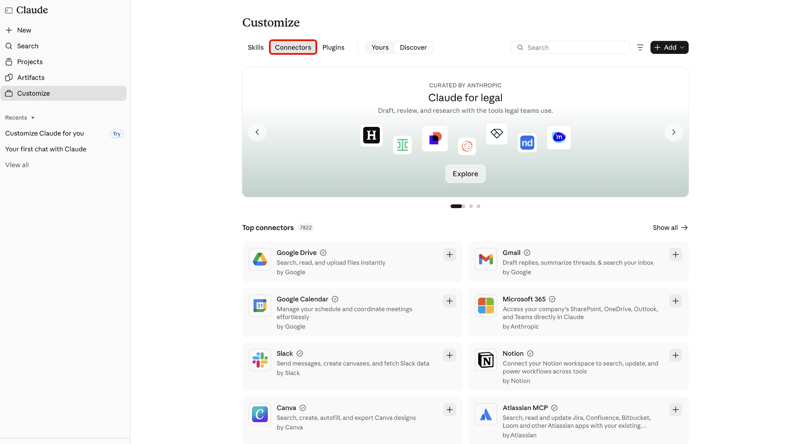

# 适用于AI平台的Adobe CX Enterprise Coworker

使用适用于AI平台的Adobe CX Enterprise Coworker获取您已在使用的AI工具中的营销见解。 使用自然语言提问，无需切换工具。 查找每个平台中列为Adobe CX Enterprise Coworker的产品。

在[设置同事](#set-up-coworker)中查找可用的平台及其设置说明。

在AI平台上使用Co-worker不会产生额外费用。 它包含在您的CX Enterprise Coworker许可证中，使用方式引用与其他同事功能相同的AI积分。 有关详细信息，请参阅[Adobe Experience Platform代理作业和AI积分消耗](https://experienceleague.adobe.com/zh-hans/docs/cx-enterprise-ai/experience-cloud-ai/overview/ai-credit-consumption){target="_blank"}。

<!-- TODO: architecture diagram pending from engineering. KT page notes "to be provided on 8/28"; still outstanding as of 8/31. Insert here once received. -->

## 先决条件 {#prerequisites}

在AI平台中使用同事之前，请确认您具备以下条件。

* 为您的组织配置的Adobe CX Enterprise Coworker，以及您在Adobe中拥有的对它的访问权限。
* Adobe Experience Platform以及Adobe Real-Time CDP、Adobe Journey Optimizer或Adobe Customer Journey Analytics中的至少一个。
* 访问[设置同事](#set-up-coworker)中列出的AI平台。

## 数据访问和权限 {#data-access-and-permissions}

AI平台中的同事反映的数据和访问级别与您的Adobe身份相同。 您可以查询和查看的内容与您在Experience Platform及其相关解决方案中有权查看的内容相匹配。 同事会继承这些权限，因此AI平台集成不需要单独的权限设置。 Co-worker会返回只读见解，而不会修改您的客户数据。 在使用生成的摘要和分析做出业务决策之前，请对其进行审阅。

<!-- Confirmed by PM (Siddhartha Srivastava) on 2026-09-02 for Microsoft 365 Copilot, Claude, and ChatGPT. Validate this permissions model for each additional platform before adding its setup tab. -->

## 主要用例 {#key-use-cases}

在AI平台中使用同事可加快常见营销工作流的速度，而无需离开您的日常工具。

| 用例 | 说明 |
| --- | --- |
| 计划和审查活动 | 规划营销活动，包括合作伙伴营销活动审查和受众预测。 比较一段时间内的促销活动效果，并确定哪些接触点可促进转化。 |
| 监测历程和活动准备情况 | 审查和监控活动营销活动，分析客户历程，并评估营销活动就绪性。 跟踪历程性能和流失以查明优化机会。 |
| 检索运营分析 | 确定哪些受众规模最大或参与度最高，以便能够优先安排工作重点，并跟踪区段随时间的增长或缩减情况。 |
| 优化工作流和内容 | 优化工作流并确定CX促销活动的资源和内容需求。 生成有关营销活动效果的可视化报告，而无需手动构建查询或功能板。 |
| 更快速地协作并做出决策 | 使用建议的提示浏览受众、营销活动和Web流量。 在规划会议期间与您的团队分享见解，并在查看计划或平台时实时回答临时问题。 |

<!-- Use cases approved by PM Siddhartha Srivastava on 2026-08-31 and confirmed for Microsoft 365 Copilot, Claude, and ChatGPT on 2026-09-02. Validate applicability for each additional platform before adding its setup tab. -->

## 设置同事 {#set-up-coworker}

选择可用的平台获取设置说明。 安装后，请尝试[示例提示](#example-prompts)。

>[!BEGINTABS]

>[!TAB Microsoft 365 Copilot]

使用[!DNL Adobe CX Enterprise Coworker for Copilot]获取[!DNL Microsoft 365 Copilot]中的营销见解。

在开始之前，请确认您有权访问[!DNL Microsoft 365 Copilot]。

**为您的组织设置同事**

管理员必须先完成这些步骤，最终用户才能在[!DNL Microsoft 365 Copilot]中访问同事。

1. 在[!DNL Microsoft 365 admin center]中，确认您的租户设置允许外部发布者构建的应用和代理。
1. 在[!DNL Microsoft 365 admin center]和[!DNL Teams admin center]中批准&#x200B;**[!UICONTROL Adobe CX Enterprise Coworker]**。 您通常可以通过[!DNL Microsoft Commercial Marketplace]或您组织的&#x200B;**[!UICONTROL 集成应用程序]**&#x200B;列表找到代理。
1. 将代理部署到最终用户。 您可以将其部署到特定用户或组，或者部署到整个组织。 您启用的用户数量不会影响设置或成本。

>[!NOTE]
>
>如果[!DNL Microsoft]将更新发布到需要新权限的同事，则管理员必须在[!DNL Agent Registry]中批准该更新，然后才能将其转出到您的用户。

**访问[!DNL Copilot]**&#x200B;中的同事

管理员启用同事后，您可以在[!DNL Microsoft 365 Copilot]界面（包括[!DNL Teams]、[!DNL Word]、[!DNL Excel]、[!DNL PowerPoint]和Web聊天）中访问它。

在[!DNL Microsoft 365 Copilot]中，选择&#x200B;**[!UICONTROL 代理]**，然后选择&#x200B;**[!UICONTROL 更多代理]**。

接下来，在代理目录中选择&#x200B;**[!UICONTROL Adobe CX Enterprise Coworker]**。

最后，选择&#x200B;**[!UICONTROL 添加]**&#x200B;以将同事添加到代理。

>[!TAB ChatGPT]

使用[!DNL Adobe CX Enterprise Coworker for ChatGPT]获取[!DNL ChatGPT]中的营销见解。

在开始之前，请确认您有权访问[!DNL ChatGPT]。

**为您的组织设置同事**

* 要求您的[!DNL ChatGPT]管理员为选定的用户或整个组织批准&#x200B;**[!UICONTROL Adobe CX Enterprise Coworker]**。

**访问[!DNL ChatGPT]**&#x200B;中的同事

在[!DNL ChatGPT]中，选择&#x200B;**[!UICONTROL 插件]**。

接下来，在插件目录中查找并选择&#x200B;**[!UICONTROL Adobe CX Enterprise Coworker]**。

在Adobe的搜索结果中突出显示了包含Adobe CX Enterprise Coworker列表的

最后，选择&#x200B;**[!UICONTROL 安装插件]**&#x200B;以将同事添加到[!DNL ChatGPT]。

ChatGPT中的

>[!TAB 克劳德]

使用同事获取[!DNL Claude]中的营销见解。

在开始之前，请确认您有权访问[!DNL Claude]。

**为您的组织设置同事**

* 要求您的[!DNL Claude]管理员为选定的用户或整个组织批准&#x200B;**[!UICONTROL Adobe CX Enterprise Coworker]**。

**访问[!DNL Claude]**&#x200B;中的同事

1. 在[!DNL Claude]中，选择&#x200B;**[!UICONTROL 自定义]**。

   

1. 选择&#x200B;**[!UICONTROL 连接器]**，然后选择&#x200B;**[!UICONTROL 发现]**，并使用&#x200B;**[!UICONTROL 搜索]**&#x200B;来查找Adobe CX Enterprise Coworker。

   

1. 选择&#x200B;**[!UICONTROL Adobe CX Enterprise Coworker]**，然后选择&#x200B;**[!UICONTROL 连接到克劳德]**。

   

1. 使用您的Adobe凭据登录以将同事连接到[!DNL Claude]。

>[!ENDTABS]

<!-- Setup steps above reflect the real customer-facing flow confirmed by PM (Siddhartha Srivastava) on 2026-09-02: an org admin approves the connector or plugin, then end users find and add it in their platform's catalog and sign in. The previous version of this file described a manual MCP-connector setup for ChatGPT (Settings > Connectors > paste server URL) -- PM clarified that flow is for internal testing only, not the customer path, so it was removed here. -->

## 示例提示 {#example-prompts}

在支持的平台上设置Co-worker后，请尝试这些提示，或以自然语言编写自己的提示。

* 显示您的前五个受众。
* 显示上个月的量度。
* 显示您活动的Workfront项目。
* 显示具有忠诚度受众的历程。

## 已知限制 {#known-limitations}

AI平台中的同事不支持每种集成模式。

* 无法使用MCP将同事连接到您自己的代理配线。

## 对AI平台中的同事进行故障诊断 {#troubleshoot}

如果您在AI平台中使用同事时遇到问题，请尝试这些步骤。

* 如果您看到错误，请注销并使用您的Adobe凭据再次登录。 重新身份验证解决了大多数问题。
* 如果您无法访问同事或特定数据，请联系Adobe管理员以确认您的产品访问权限和权限。

<!--
Editorial maintenance, 2026-10-27:
Only approved platforms with validated setup guidance belong in the rendered tab set.
Remaining platforms to add: Gemini, Amazon Quick, IBM, and Databricks.

To add an approved platform:
* Confirm approval and obtain access to the customer flow.
* Validate prerequisites, organization approval, catalog discovery, listing name, installation, and Adobe sign-in.
* Confirm the shared licensing, permissions, use cases, prompts, limitations, and troubleshooting guidance applies.
* Add one tab before ENDTABS, following the existing order: introduction, platform prerequisites, organization setup, and user access.
* Document any platform-specific requirements or exceptions within that tab.
* Preview the tab and verify its links and image references.
Keep the introduction, metadata, and shared prerequisites free of platform lists so adding a tab does not require duplicate updates.

Gemini draft scope:
No setup steps are confirmed. Validate the complete customer flow and all shared guidance before adding the tab.
Do not infer the flow from another platform.
-->
