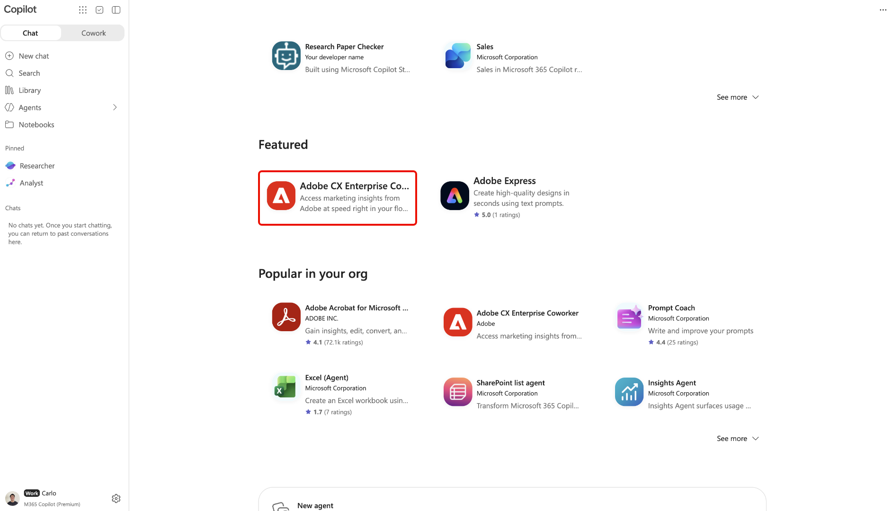
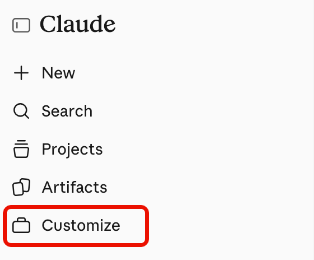
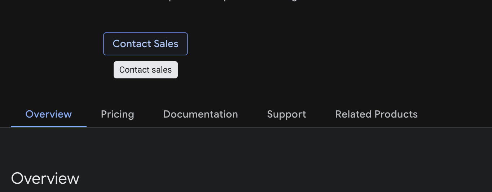
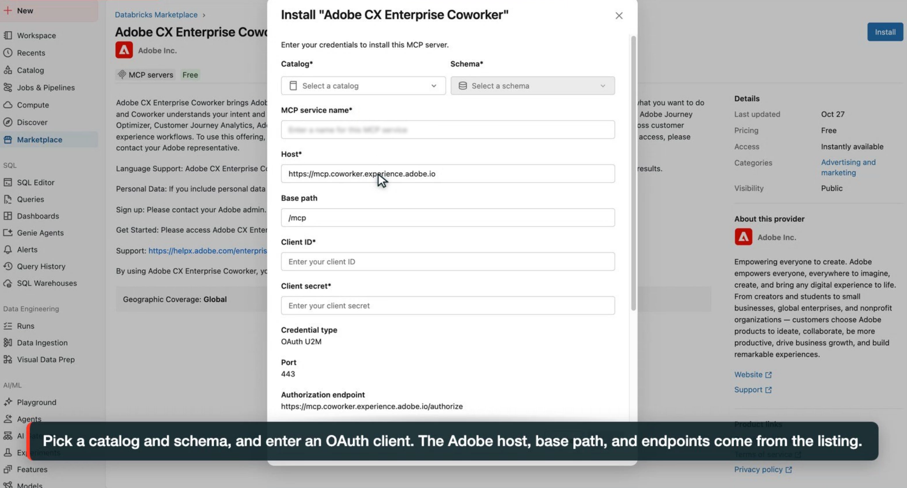

# 适用于AI平台的Adobe CX Enterprise Coworker

使用适用于AI平台的Adobe CX Enterprise Coworker获取您已在使用的AI工具中的营销见解。 使用自然语言提问，无需切换工具。 查找每个平台中列为Adobe CX Enterprise Coworker的产品。

在[设置同事](#set-up-coworker)中查找可用的平台及其设置说明。

在AI平台上使用Co-worker不会产生额外费用。 它包含在您的CX Enterprise Coworker许可证中，使用方式引用与其他同事功能相同的AI积分。 有关详细信息，请参阅[Adobe Experience Platform代理作业和AI积分消耗](https://experienceleague.adobe.com/zh-hans/docs/cx-enterprise-ai/experience-cloud-ai/overview/ai-credit-consumption){target="_blank"}。

<!-- TODO: architecture diagram pending from engineering. KT page notes "to be provided on 8/28"; still outstanding as of 8/31. Insert here once received. -->

## 先决条件 {#prerequisites}

在AI平台中使用同事之前，请确认您具备以下条件。

* 为您的组织配置的Adobe CX Enterprise Coworker，以及您在Adobe中拥有的对它的访问权限。
* Adobe Experience Platform以及Adobe Real-Time CDP、Adobe Journey Optimizer或Adobe Customer Journey Analytics中的至少一个。
* 访问[设置同事](#set-up-coworker)中列出的AI平台。

## 数据访问和权限 {#data-access-and-permissions}

AI平台中的同事反映的数据和访问级别与您的Adobe身份相同。 您可以查询和查看的内容与您在Experience Platform及其相关解决方案中有权查看的内容相匹配。 同事会继承这些权限，因此AI平台集成不需要单独的权限设置。 Co-worker会返回只读见解，而不会修改您的客户数据。 在使用生成的摘要和分析做出业务决策之前，请对其进行审阅。

<!-- Confirmed by PM (Siddhartha Srivastava) on 2026-09-02 for Microsoft 365 Copilot, Claude, and ChatGPT. Validate this permissions model for each additional platform before adding its setup section. -->

## 主要用例 {#key-use-cases}

在AI平台中使用同事可加快常见营销工作流的速度，而无需离开您的日常工具。

| 用例 | 说明 |
| --- | --- |
| 计划和审查活动 | 规划营销活动，包括合作伙伴营销活动审查和受众预测。 比较一段时间内的促销活动效果，并确定哪些接触点可促进转化。 |
| 监测历程和活动准备情况 | 审查和监控活动营销活动，分析客户历程，并评估营销活动就绪性。 跟踪历程性能和流失以查明优化机会。 |
| 检索运营分析 | 确定哪些受众规模最大或参与度最高，以便能够优先安排工作重点，并跟踪区段随时间的增长或缩减情况。 |
| 优化工作流和内容 | 优化工作流并确定CX促销活动的资源和内容需求。 生成有关营销活动效果的可视化报告，而无需手动构建查询或功能板。 |
| 更快速地协作并做出决策 | 使用建议的提示浏览受众、营销活动和Web流量。 在规划会议期间与您的团队分享见解，并在查看计划或平台时实时回答临时问题。 |

<!-- Use cases approved by PM Siddhartha Srivastava on 2026-08-31 and confirmed for Microsoft 365 Copilot, Claude, and ChatGPT on 2026-09-02. Validate applicability for each additional platform before adding its setup section. -->

## 设置同事 {#set-up-coworker}

选择可用的平台获取设置说明。 安装后，请尝试[示例提示](#example-prompts)。

* [Microsoft 365 Copilot](#microsoft-365-copilot)
* [ChatGPT](#chatgpt)
* [克劳德](#claude)
* [Gemini企业版](#gemini-enterprise)
* [Amazon快速](#amazon-quick)
* [IBM Watsonx Orchestrate](#ibm-watsonx-orchestrate)
* [数据块](#databricks)

### [!DNL Microsoft 365 Copilot] {#microsoft-365-copilot}

使用[!DNL Adobe CX Enterprise Coworker for Copilot]获取[!DNL Microsoft 365 Copilot]中的营销见解。

在开始之前，请确认您有权访问[!DNL Microsoft 365 Copilot]。

#### 设置组织访问权限 {#copilot-organization-setup}

管理员必须先完成这些步骤，最终用户才能在[!DNL Microsoft 365 Copilot]中访问同事。

1. 在[!DNL Microsoft 365 admin center]中，确认您的租户设置允许外部发布者构建的应用和代理。
1. 在[!DNL Microsoft 365 admin center]和[!DNL Teams admin center]中批准&#x200B;**[!UICONTROL Adobe CX Enterprise Coworker]**。 您通常可以通过[!DNL Microsoft Commercial Marketplace]或您组织的&#x200B;**[!UICONTROL 集成应用程序]**&#x200B;列表找到代理。
1. 将代理部署到最终用户。 您可以将其部署到特定用户或组，或者部署到整个组织。 您启用的用户数量不会影响设置或成本。

>[!NOTE]
>
>如果[!DNL Microsoft]将更新发布到需要新权限的同事，则管理员必须在[!DNL Agent Registry]中批准该更新，然后才能将其转出到您的用户。

#### 访问同事 {#copilot-access}

管理员启用同事后，您可以在[!DNL Microsoft 365 Copilot]界面（包括[!DNL Teams]、[!DNL Word]、[!DNL Excel]、[!DNL PowerPoint]和Web聊天）中访问它。

在[!DNL Microsoft 365 Copilot]中，选择&#x200B;**[!UICONTROL 代理]**，然后选择&#x200B;**[!UICONTROL 更多代理]**。

接下来，在代理目录中选择&#x200B;**[!UICONTROL Adobe CX Enterprise Coworker]**。

最后，选择&#x200B;**[!UICONTROL 添加]**&#x200B;以将同事添加到代理。

### [!DNL ChatGPT] {#chatgpt}

使用[!DNL Adobe CX Enterprise Coworker for ChatGPT]获取[!DNL ChatGPT]中的营销见解。

在开始之前，请确认您有权访问[!DNL ChatGPT]。

#### 设置组织访问权限 {#chatgpt-organization-setup}

添加同事之前，管理员必须批准该同事。

* 要求您的[!DNL ChatGPT]管理员为选定的用户或整个组织批准&#x200B;**[!UICONTROL Adobe CX Enterprise Coworker]**。

#### 访问同事 {#chatgpt-access}

在[!DNL ChatGPT]中，选择&#x200B;**[!UICONTROL 插件]**。

接下来，在插件目录中查找并选择&#x200B;**[!UICONTROL Adobe CX Enterprise Coworker]**。

在Adobe的搜索结果中突出显示了包含Adobe CX Enterprise Coworker列表的

最后，选择&#x200B;**[!UICONTROL 安装插件]**&#x200B;以将同事添加到[!DNL ChatGPT]。

ChatGPT中的

### [!DNL Claude] {#claude}

使用同事获取[!DNL Claude]中的营销见解。

在开始之前，请确认您有权访问[!DNL Claude]。

#### 设置组织访问权限 {#claude-organization-setup}

添加同事之前，管理员必须批准该同事。

* 要求您的[!DNL Claude]管理员为选定的用户或整个组织批准&#x200B;**[!UICONTROL Adobe CX Enterprise Coworker]**。

#### 访问同事 {#claude-access}

1. 在[!DNL Claude]中，选择&#x200B;**[!UICONTROL 自定义]**。

   

1. 选择&#x200B;**[!UICONTROL 连接器]**，然后选择&#x200B;**[!UICONTROL 发现]**，并使用&#x200B;**[!UICONTROL 搜索]**&#x200B;来查找Adobe CX Enterprise Coworker。

   

1. 选择&#x200B;**[!UICONTROL Adobe CX Enterprise Coworker]**，然后选择&#x200B;**[!UICONTROL 连接到克劳德]**。

   

1. 使用您的Adobe凭据登录以将同事连接到[!DNL Claude]。

### [!DNL Gemini Enterprise] {#gemini-enterprise}

使用同事获取[!DNL Gemini Enterprise]中的营销见解。

在开始之前，请确认您有权访问[!DNL Gemini Enterprise]。

#### 设置组织访问权限 {#gemini-organization-setup}

作为[!DNL Gemini Enterprise]管理员，请完成这些步骤以使同事可供您的组织使用。

1. 转到[Gemini Enterprise AI代理市场](https://console.cloud.google.com/marketplace/browse?filter=solution-type:ai-agent-service)。
1. 搜索Adobe CX Enterprise Coworker，然后选择&#x200B;**[!UICONTROL Adobe CX Enterprise Coworker]**&#x200B;代理卡片。
1. 在代理信息卡上，选择&#x200B;**[!UICONTROL 联系销售人员]**。

   {width="700"}

1. 填写表单以向Adobe提交请求。

   {width="600"}

   Adobe可免费创建私有选件，并通过电子邮件向您发送链接。

1. 打开通过电子邮件发送的链接并批准私有选件。

   批准优惠后，Adobe将为您的[!DNL Gemini Enterprise]帐户启用代理。

1. 将代理发布到您组织中的选定用户或所有企业用户。

#### 访问同事 {#gemini-access}

管理员向您发布同事后，在[!DNL Gemini Enterprise]中打开该工作流程以开始提问。

1. 在[!DNL Gemini Enterprise]中，转到&#x200B;**[!UICONTROL 代理]**&#x200B;目录。
1. 搜索Adobe CX Enterprise Coworker。
1. 选择&#x200B;**[!UICONTROL Adobe CX Enterprise Coworker]**&#x200B;并输入提示以开始。

有关想法，请探索[主要用例](#key-use-cases)和[示例提示](#example-prompts)。

### [!DNL Amazon Quick] {#amazon-quick}

使用同事获取[!DNL Amazon Quick]中的营销见解。

在开始之前，请确认您有权访问[!DNL Amazon Quick]和您的Adobe帐户。

#### 连接同事 {#amazon-quick-connection}

使用模型上下文协议(MCP)连接[!DNL Amazon Quick]中的辅助进程。 Adobe已为此连接批准[!DNL Amazon Quick]。

1. 在[!DNL Amazon Quick]中，转到&#x200B;**[!UICONTROL 连接器]**。
1. 搜索MCP并打开连接器设置。
1. 输入`https://mcp.coworker.experience.adobe.io`作为MCP服务器URL。

   等待几分钟以完成连接并注册。

1. 按照设置提示操作，然后使用您的Adobe凭据登录。
1. 在开始询问问题之前，请确认连接是否成功。

#### 访问同事 {#amazon-quick-access}

连接同事后，在[!DNL Amazon Quick]中使用它来询问有关Adobe数据的问题。

有关想法，请探索[主要用例](#key-use-cases)和[示例提示](#example-prompts)。

### [!DNL IBM watsonx Orchestrate] {#ibm-watsonx-orchestrate}

使用同事获取[!DNL IBM watsonx Orchestrate]中的营销见解。

在开始之前，请确认您有权访问[!DNL IBM watsonx Orchestrate]和您的Adobe帐户。

您还需要权限来管理连接、注册MCP服务器和编辑代理。 在安装之前，与您的Adobe代表确认您的OAuth客户端设置。

#### 创建您的同事连接 {#ibm-connection}

使用OAuth连接同事，然后使用您的Adobe帐户进行身份验证。 以下步骤准备连接，以在草稿环境中进行测试。

1. 在[!DNL IBM watsonx Orchestrate]中，转到&#x200B;**[!UICONTROL 连接]**，然后选择&#x200B;**[!UICONTROL 添加连接]**。
1. 输入&#x200B;**[!UICONTROL 连接ID]**、**[!UICONTROL 显示名称]**&#x200B;和可选的&#x200B;**[!UICONTROL 连接描述]**，然后选择&#x200B;**[!UICONTROL 保存并继续]**。
1. 在&#x200B;**[!UICONTROL 配置草稿环境]**&#x200B;中，选择&#x200B;**[!UICONTROL OAuth2授权代码]**&#x200B;作为&#x200B;**[!UICONTROL 身份验证类型]**。
1. 输入连接设置。

   | 字段 | 值 |
   | --- | --- |
   | [!UICONTROL 服务器URL] | `https://mcp.coworker.experience.adobe.io` |
   | [!UICONTROL 令牌URL] | 为您的OAuth客户端确认的令牌端点。 |
   | [!UICONTROL 授权URL] | 为您的OAuth客户端确认的授权端点。 |
   | [!UICONTROL 客户端ID] | 您批准的OAuth客户端ID。 |
   | [!UICONTROL 客户端密码] | 您批准的OAuth客户端密钥。 |

   {width="700"}

1. 选择&#x200B;**[!UICONTROL PKCE]**&#x200B;和&#x200B;**[!UICONTROL 成员凭据]**，然后选择&#x200B;**[!UICONTROL 下一步]**。
1. 完成&#x200B;**[!UICONTROL 配置实时环境]**，然后选择&#x200B;**[!UICONTROL 完成]**&#x200B;以保存连接。

<!-- Confirm the customer process for obtaining OAuth settings before publication. -->

#### 使用Adobe登录 {#ibm-sign-in}

添加成员凭据以验证与您的Adobe身份的连接。

1. 转到&#x200B;**[!UICONTROL 设置]** > **[!UICONTROL 成员凭据]**，然后选择&#x200B;**[!UICONTROL 添加成员凭据]**。
1. 选择您的同事连接并继续&#x200B;**[!UICONTROL 设置凭据]**。
1. 选择&#x200B;**[!UICONTROL 连接并保存]**，然后在出现提示时使用您的Adobe凭据登录。
1. 返回到[!DNL IBM watsonx Orchestrate]并确认您的凭据已成功添加。

#### 注册MCP服务器 {#ibm-register-server}

通过模型上下文协议(MCP)注册协同工作以将其工具导入[!DNL IBM watsonx Orchestrate]。

1. 转到&#x200B;**[!UICONTROL AI网关]** > **[!UICONTROL MCP服务器]**，然后选择&#x200B;**[!UICONTROL 注册服务器]**。
1. 输入服务器设置。

   | 字段 | 值 |
   | --- | --- |
   | [!UICONTROL 服务器名称] | 描述性名称，如`cx-coworker`。 |
   | [!UICONTROL 传输类型] | [!UICONTROL 可流式处理HTTP] |
   | [!UICONTROL MCP服务器URL] | `https://mcp.coworker.experience.adobe.io` |
   | [!UICONTROL Connection] | 您已验证的同事连接。 |

1. 选择&#x200B;**[!UICONTROL 注册]**&#x200B;并等待服务器注册和工具导入完成。

   {width="700"}

#### 向代理添加工具 {#ibm-agent-tools}

将导入的工具添加到代理，然后在部署代理之前测试连接。

1. 转到&#x200B;**[!UICONTROL 活动清单]** > **[!UICONTROL 代理]**&#x200B;并打开要配置的代理。
1. 在&#x200B;**[!UICONTROL 生成]**&#x200B;中，选择&#x200B;**[!UICONTROL 工具]**，然后选择&#x200B;**[!UICONTROL 添加工具]**。
1. 选择&#x200B;**[!UICONTROL MCP服务器]**&#x200B;并从已注册的Co-worker服务器中查找工具。
1. 选择您需要的同事工具，然后选择&#x200B;**[!UICONTROL 添加到代理]**。
1. 在&#x200B;**[!UICONTROL 草稿预览]**&#x200B;中输入提示并查看响应以确认连接是否正常工作。

有关想法，请探索[主要用例](#key-use-cases)和[示例提示](#example-prompts)。

### [!DNL Databricks] {#databricks}

使用同事获取[!DNL Databricks Genie One]中的营销见解。

在开始之前，请确认您有权访问[!DNL Databricks Genie One]和您的Adobe帐户。 您还需要权限才能在所选[!DNL Unity Catalog]目录和架构中安装MCP服务。

在安装之前，与您的Adobe代表确认您的OAuth客户端设置。

#### 安装同事 {#databricks-install}

从[!DNL Databricks Marketplace]安装协同MCP服务。

1. 在[!DNL Databricks]中，转到&#x200B;**[!UICONTROL Marketplace]**&#x200B;并搜索Adobe同事。
1. 选择&#x200B;**[!UICONTROL Adobe CX Enterprise Coworker]**，然后选择&#x200B;**[!UICONTROL 安装]**。
1. 选择&#x200B;**[!UICONTROL 目录]**&#x200B;和&#x200B;**[!UICONTROL 架构]**，然后输入&#x200B;**[!UICONTROL MCP服务名称]**。
1. 保留由列表提供的连接设置，包括以下值。

   | 字段 | 值 |
   | --- | --- |
   | [!UICONTROL 主机] | `https://mcp.coworker.experience.adobe.io` |
   | [!UICONTROL 基本路径] | `/mcp` |
   | [!UICONTROL 凭据类型] | [!UICONTROL OAuth U2M] |

   {width="700"}

1. 输入您的&#x200B;**[!UICONTROL 客户端ID]**&#x200B;和&#x200B;**[!UICONTROL 客户端密钥]**。
1. 查看并接受条款，然后选择&#x200B;**[!UICONTROL 安装]**。

<!-- Confirm the customer process for obtaining OAuth settings before publication. -->

#### 连接您的Adobe帐户 {#databricks-adobe-connection}

每个用户均使用其Adobe帐户登录。 同事请求使用该用户的Adobe权限。

1. 在&#x200B;**[!UICONTROL 目录]**&#x200B;中，在选定目录和架构下打开已安装的协同工作服务。
1. 出现提示时，完成Adobe登录。
1. 确认服务&#x200B;**[!UICONTROL 状态]**&#x200B;为&#x200B;**[!UICONTROL 活动]**&#x200B;并且列出了其工具。
1. 在&#x200B;**[!UICONTROL 开始]**&#x200B;中，选择&#x200B;**[!UICONTROL Genie]**，然后选择&#x200B;**[!UICONTROL Genie One]**，然后选择&#x200B;**[!UICONTROL 添加到Genie One]**。

#### 访问同事 {#databricks-access}

在[!DNL Genie One]中提出问题之前，请确认您的连接器可用。

1. 在[!DNL Genie One]中，转到&#x200B;**[!UICONTROL 自定义项]** > **[!UICONTROL 连接器]**&#x200B;并打开您的Co-worker连接器。
1. 确认连接器显示&#x200B;**[!UICONTROL 已连接]**。 根据贵组织的策略审查工具批准设置。

   {width="700"}

1. 选择&#x200B;**[!UICONTROL 新建聊天]**&#x200B;并输入提示，如“使用Adobe同事，列出已发布的受众”。

有关想法，请探索[主要用例](#key-use-cases)和[示例提示](#example-prompts)。

<!-- Setup steps for Microsoft 365 Copilot, ChatGPT, and Claude reflect the real customer-facing flow confirmed by PM (Siddhartha Srivastava) on 2026-09-02: an org admin approves the connector or plugin, then end users find and add it in their platform's catalog and sign in. The previous version of this file described a manual MCP-connector setup for ChatGPT (Settings > Connectors > paste server URL) -- PM clarified that flow is for internal testing only, not the customer path, so it was removed here. -->

<!-- Amazon Quick setup follows PM guidance from the October 28, 2026 email, "Coworker in AI Platforms screenshots - Gemini / Amazon Quick." End users connect through MCP and sign in with Adobe credentials. -->

## 示例提示 {#example-prompts}

在支持的平台上设置Co-worker后，请尝试这些提示，或以自然语言编写自己的提示。

* 显示您的前五个受众。
* 显示上个月的量度。
* 显示您活动的Workfront项目。
* 显示具有忠诚度受众的历程。

## 已知限制 {#known-limitations}

AI平台中的Co-worker不支持Co-worker界面中的所有可用功能。

* 您无法将Co-worker连接到本文档中列出的受支持AI平台之外的自定义代理工具。 要通过MCP请求对其他AI平台或代理功能提供支持，请联系您的Adobe代表。
* 通过Claude访问同事时，无法使用Firefly图像生成技能。 该技能在协同工作界面中以及本文档中描述的其他受支持AI平台中仍然可用。 要使用Firefly图像生成技能，请通过同事界面或其他受支持的AI平台访问同事。

## 对AI平台中的同事进行故障诊断 {#troubleshoot}

如果您在AI平台中使用同事时遇到问题，请尝试这些步骤。

* 如果您看到错误，请注销并使用您的Adobe凭据再次登录。 重新身份验证解决了大多数问题。
* 如果您无法访问同事或特定数据，请联系Adobe管理员以确认您的产品访问权限和权限。

<!--
Editorial maintenance, 2026-10-27:
Only approved platforms with validated setup guidance belong in the platform sections.
Databricks setup follows the supplied "Adobe Coworker in Genie One.mp4" walkthrough. Confirm marketplace availability and customer OAuth provisioning before publication.

To add an approved platform:
* Confirm approval and obtain access to the customer flow.
* Validate prerequisites, organization approval, catalog discovery, listing name, installation, and Adobe sign-in.
* Confirm the shared licensing, permissions, use cases, prompts, limitations, and troubleshooting guidance applies.
* Add an H3 platform section with an explicit anchor under Set up Coworker and add it to the linked platform list.
* Follow the existing order: introduction, platform prerequisites, setup tasks, and user access. Use H4 task headings with unique anchors.
* Document any platform-specific requirements or exceptions within that section.
* Preview the section and verify its links and image references.
Keep the article introduction, metadata, and shared prerequisites free of platform lists so adding a section does not require duplicate updates.

Gemini Enterprise follow-up:
Administrator setup and end user access steps are documented. Confirm applicability of the shared guidance before expanding the section.
-->
