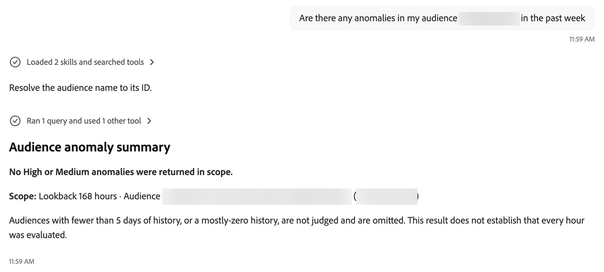

# 检测Experience Platform异常

使用[!DNL Adobe CX Enterprise Coworker]聊天来识别支持的Adobe Experience Platform指标中的尖峰和下降。 询问数据流和受众以找出与基线的偏差。

先从宽泛的问题开始，然后关注需要关注的流量或受众。 在决定调查内容之前，请查看报告的量度及其基线。

>[!AVAILABILITY]
>
>异常检测在有限可用性中。 计划于2027年第一季度全面推出。

>[!NOTE]
>
>异常检测在不更改数据或配置的情况下提供信息。

## 可用的诊断技能

使用`baseline-anomalies`插件检测异常、比较趋势，并查看流运行状况或当前作业失败。 该插件默认使用[!DNL Coworker]中的Experience Platform和Apps产品进行配置。

根据您需要的信息选择问题类型。

| 技能 | 用途 |
| --- | --- |
| [!UICONTROL 基线异常搜索流异常] | 在摄取、分段、导出和目标阶段检测记录卷中的尖峰或骤减以及失败的记录。 |
| [!UICONTROL 基线异常搜索受众异常] | 检测已实现受众配置文件计数中的尖峰或下降，以及退出配置文件计数中的尖峰。 |
| [!UICONTROL 基线异常汇总流量趋势] | 比较近期和典型流量吞吐量，而不进行异常判断。 |
| [!UICONTROL 基线异常汇总受众趋势] | 比较近期和典型符合条件的用户档案计数和退出用户档案计数，以进行批量分段，而不会出现异常判断或预期范围。 |
| [!UICONTROL 基线异常检查流运行状况] | 查看已消除重复的成功和失败的运行计数，以及按活动或流程显示的失败记录总数。 |
| [!UICONTROL 基线异常搜索失败的作业] | 查看当前失败的作业及其失败原因，不包括恢复的失败和各个记录的详细信息。 |

趋势摘要描述的是变化，但并不确定这些变化是否为异常。 在需要尖峰或下降评估时使用异常问题。

## 开始之前

该插件默认配置。 要在询问诊断问题之前检查其状态，请执行以下步骤。

1. 转到&#x200B;**[!UICONTROL 自定义项]**。

1. 选择&#x200B;**[!UICONTROL 插件]**。

1. 打开&#x200B;**[!UICONTROL 基线异常]**&#x200B;并确认其状态为&#x200B;**[!UICONTROL 活动]**。

识别要检查的沙盒和区域。 对于特定资源，为其流、区段或目标名称或标识符准备就绪。

有关一般聊天说明，请参阅[开始聊天](/help/chat/ui-guide.md)。

## 询问异常

描述要检查的区域或资源以及要检查的时段。

使用以下示例提示作为起点。 将示例名称替换为您的组织名称。

| 目标 | 示例提示 |
| --- | --- |
| 跨受支持的区域检查 | 过去24小时内有什么异常吗？ |
| 检查引入 | 过去24小时内我的摄取是否存在任何异常？ |
| 检查特定流程 | 在过去24小时内，摄取流CustomerImport是否存在任何异常？ |
| 检查分段 | 过去24小时内我的分段是否存在任何异常？ |
| 检查特定区段 | 过去24小时内区段LoyaltyMembers是否存在任何异常？ |
| 检查目标激活 | 过去24小时内，我的目标激活是否存在任何异常？ |
| 检查已实现的配置文件峰值 | 今天是否有受众看到已实现用户档案的激增？ |
| 检查失败的记录异常 | 失败记录在流量CustomerImport上是否异常高？ |

这个广泛的问题会检查数据流和受众。 确认响应中标识的沙盒和时间段。

<!-- Author review: Confirm exact supported time windows, defaults, time zone handling, and data freshness. -->

## 查看异常结果

比较受影响资源和时间段的报告值及其基线。 使用差异来确定哪些内容需要进一步调查，而不是将异常视为已确认的原因。

例如，摄取输入记录的减少可识别卷更改。 这一变化本身并不能解释为何记录数量减少了。

结果可以显示为表格或书面摘要。 表可以对[!UICONTROL 高风险]和[!UICONTROL Medium风险]下的异常进行分组。

{width="900" zoomable="yes"}

此示例按风险对流量异常进行分组，并建议调查运行计数或趋势历史记录。 资源名称和值将被密文。

| 结果详细信息 | 要审阅的内容 |
| --- | --- |
| [!UICONTROL 时间(UTC)] | 协调世界时中的事件时间或时间窗口。 |
| [!UICONTROL 阶段] | 受影响的处理阶段，如摄取或目标。 |
| [!UICONTROL 流量] | 受影响的流，由名称或标识符标识。 |
| [!UICONTROL 发生什么情况] | 检测到更改，如卷激增或骤减。 |
| [!UICONTROL 实际与预期] | 观察值与基线或预期范围比较。 |

查看风险分组旁边的说明。 对于受众异常，高表示与正常值有很大偏差。 Medium表明了一种明确但温和的偏离。 仅返回“高”和“Medium”异常。

当基线历史记录是高度可变的，受众结果会排除Medium异常。 因此，任何返回的、历史记录高度可变的异常均具有高风险级别。

使用风险层来排定调查优先级，而不是确定根本原因。

例如，一个响应将10条输入记录与1到4的预期范围对应识别为中等风险尖峰。 通常的水平大约是一条记录，因此相对于基线，偏差较大。 绝对体积仍然很小。

在将历史异常视为当前问题之前检查事件时间。 过去24小时以外的事件不会建立基础条件是否恢复。

<!-- Author review: Confirm flow risk tier definitions and whether persistence is reported. -->

### 基线和预期范围

每小时异常比较使用过去14天的同一小时。 这可以解释每小时典型的模式，但不能解释更广泛的季节性。

对于受众异常，预期范围以中间值为中心，并根据历史计数的变化而扩大。 如果计算出的下限为负，则范围将改用最低的历史计数。 因此，范围可以延伸到中间值之上而不是其之下。

超过预期范围的已实现配置文件计数达到峰值。 低于此范围的计数会下降。 如果用户档案通常存在，则清点为零即为“高风险下降”。

退出用户档案计数仅生成尖峰判决。 出口越少被视为正常，而不是下降异常。

### 未返回异常

响应会报告请求的受众和时段未返回任何高异常或Medium异常。

{width="900" zoomable="yes"}

此示例包括有关历史记录不足或大部分为零的警告。 它不会确认每小时评估一次或排除此受众。 受众名称和标识符会被密文。

### 基线历史记录不足

基线历史记录会影响是否可以评估受众是否存在异常。

受众异常检测不评估历史记录少于五天或历史记录大部分为零的行。

>[!IMPORTANT]
>
>没有报告的异常并不表示评估了每个资源。 响应可能无法确认是评估还是跳过受众。

<!-- Author review: Confirm flow minimum history requirements and whether audience evaluation status or excluded resources can be retrieved. -->

## 优化您的问题

将您的下一个问题集中在受影响的资源上。 例如，在广泛的摄取检查后，询问命名流的异常情况。

在询问了过去24小时的相关问题后，可通过以下跟进来延长相关期限：

```text
What about in the past two weeks?
```

响应可以识别历史异常，即使过去24小时内未出现任何异常也是如此。

要更仔细地调查，请询问流量运行计数、流量趋势、受众趋势或当前失败的作业。 您还可以在调查时询问有关个别作业的信息。

根据您需要的信息选择下一个问题。 趋势和健康摘要不提供异常判决。

| 目标 | 示例提示 | 期待完成的任务 |
| --- | --- | --- |
| 查看受众趋势 | 上周我的受众发生了什么变化？ | 用于批处理分段的最近和典型合格及退出的配置文件计数，没有预期范围。 |
| 审核流趋势 | 摄取量在上星期有什么变化？ | 将最近的吞吐量与典型吞吐量进行比较，没有异常判断。 |
| 审查流运行状况 | 过去24小时内，我的摄取流有多少次运行成功或失败？ | 无故障原因，消除重复的运行计数和聚合失败的记录总数。 |
| 调查失败的作业 | 哪些导出作业在过去24小时内失败，为什么？ | 其最新状态在请求的范围内失败的作业，带有作业失败原因。 |
| 调查流量故障 | 流程CustomerImport出现什么错误？ | 当前与流关联的失败作业的失败原因，没有各个记录的详细信息。 |

受众趋势历史记录会保留大约两周，即336小时。 典型值是过去14天内该小时的中间值。

对于当前失败的作业，空结果表示在请求的范围内当前没有任何作业失败。 这并不意味着在请求的时段内没有发生故障。 将排除失败且以后成功的作业。

使用运行状况检查技能继续调查，或使用警报技能为支持的资源启用警报。 这些操作使用单独的技能，而不是异常检测本身。

有关相关的警报工作流，请参阅[客户警报技能](/help/chat/use-cases/customer-alerts/customer-alerts.md)。

<!-- Author review: Validate a complete public example response and the supported alert assets and setup before adding an alert procedure. -->

## 量度引用

限量版包括以下七个跨摄取、分段和目标激活的量度。 使用此参考可标识与每个区域关联的计数。

| 面积 | 量度标识符 | 衡量的计数 |
| --- | --- | --- |
| 摄取 | `input_record_count` | 摄取流的输入记录数。 |
| 摄取 | `failed_record_count` | 摄取流的失败记录数。 |
| 区段 | `__segment_{segment_id}__realized_profiles` | 符合区段资格的用户档案数。 |
| 区段 | `__segment_{segment_id}__exited_profiles` | 退出区段的配置文件数。 |
| 目标激活 | `{destination}_input_record_count` | 目标的输入记录数。 |
| 目标激活 | `{destination}_skipped_record_count` | 目标跳过的记录数。 |
| 目标激活 | `{destination}_output_record_count` | 目标的输出记录数。 |

<!-- Author review: Confirm metric aggregation intervals and identifier visibility. -->

## 范围和限制

使用异常检测来标识偏差，而不是确认根本原因或修复资源。

您可以按名称或标识符询问有关流、区段和目标的情况。 流量异常检测包括摄取、分段、导出和目标阶段。

将失败的作业技能用于当前失败的作业及其失败原因。 排除恢复的故障。 作业诊断不包括单个记录或异常判决的详细信息。

流量运行状况提供聚合计数，而非失败原因。 趋势摘要描述的是近期值和典型值，而不是异常判决。 受众趋势摘要仅涵盖批次分段。

异常检测不会更改您的数据或配置。 对于受支持的警报操作和更深入的健康调查，请使用单独的技能。

<!-- Author review: Confirm job identifier support and any recommendation capabilities before adding examples. -->
