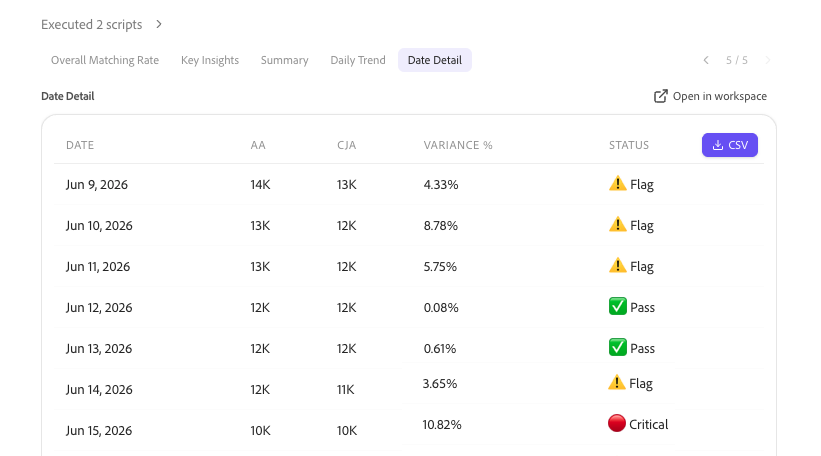

# 智能实施和管理概述

使用Adobe CX Enterprise Coworker Chat设置、迁移和管理Analytics实施，并确保您可以信任每个答案背后的数据。 同事可以计划您的实施，将计划转换为供团队跟踪的核对清单，并在收集数据后验证数据。

智能实施和管理是Co-worker Chat中的几个分析域之一。 要查看所有域，请参阅使用同事聊天分析数据中的[开始同事聊天分析](/help/chat/use-cases/data-insights/analytics-overview.md#start-analyzing-in-coworker-chat)。

**最适合于：**&#x200B;管理员

## 实施工作流程如何整合

此页面上的用例遵循一个可选的三阶段工作流。 您可以自行使用任何阶段。 例如，无需首先生成计划或核对清单，即可验证数据。

1. **计划：**&#x200B;获取个性化、有序的实施或升级计划。 请参阅[与同事一起规划实施](/help/chat/use-cases/data-insights/implementation-guide.md)。
1. **实施：**&#x200B;将您的计划转换为团队可以分配和跟踪的同事项目核对清单。 请参阅[生成同事项目的实施核对清单](/help/chat/use-cases/data-insights/intelligent-checklist.md)。
1. **验证：**&#x200B;确认您的数据已正确配置和收集。 请参阅[用例](#use-cases)表中的验证用例。

## 先决条件

<!-- FLAG: Confidence: Medium for the shared bullets. They differ from the other domain pages on purpose: planning doesn't query your data, and Experience Platform validation uses Experience Platform datasets rather than data views or report suites. The permission inheritance for Experience Platform is inferred. High for the "Additional prerequisite" notes in the Use cases table, which are sourced from the "Before you begin" section of each linked article. Some of those articles flag their own prerequisites as unconfirmed (implementation-guide.md, intelligent-checklist.md, streaming-media-validation.md), so verify those rows when those flags are resolved. Validate dataset quality for Customer Journey Analytics is a video page with no stated prerequisites, so it isn't listed. -->

要使用此页面上的用例，您需要：

* 访问同事聊天。 查看[开始使用同事聊天](/help/chat/use-cases/data-insights/analytics-chat.md)分析数据。
* 查看对要验证的数据的访问权限。 同事聊天会从其连接到的Adobe应用程序继承您的权限。

## 用例

| 用例 | 函数 |
| --- | --- |
| [计划您的实施](/help/chat/use-cases/data-insights/implementation-guide.md)

 | 创建个性化的分步计划，以在Edge上实施Customer Journey Analytics、从Adobe Analytics升级或设置Content Analytics、Marketing Campaign Analytics或流媒体收集。 计划包括所有者、工作量估计、依赖项和验证步骤等详细信息。
**示例提示：** “帮助我规划Customer Journey Analytics的实施”

**其他先决条件：**&#x200B;除了[常规先决条件](#prerequisites)之外，此用例还要求您知道哪个实施路径适用于您，以及当前环境的基本详细信息，例如您的许可状态或计划的数据摄取路径。

有关详细信息，请参阅[与同事一起规划实施](/help/chat/use-cases/data-insights/implementation-guide.md)。
 |
| [生成实施核对清单](/help/chat/use-cases/data-insights/intelligent-checklist.md)

 
实验性
 | 将您的Customer Journey Analytics实施计划转换为同事项目中的核对清单，团队可以在其中分配步骤、跟踪状态和添加批准审核。
**其他必备项：**&#x200B;除了[常规必备项](#prerequisites)之外，此用例还需要完成实施指南对话以及访问组织中的同事项目。

有关详细信息，请参阅[生成同事项目的实施核对清单](/help/chat/use-cases/data-insights/intelligent-checklist.md)。
 |
| [从Adobe Analytics升级到Customer Journey Analytics时验证数据](/help/chat/use-cases/data-insights/data-validation-aa-cja.md)

 | 比较Adobe Analytics报表包和Customer Journey Analytics数据视图之间的维度、量度和趋势，标记差异，然后推荐支持升级的修复。
**最适合于：**&#x200B;管理员、分析师

**示例提示：**
<ul><li>“将我的AA报表包与CJA数据视图进行比较”</li><li>“AA和CJA中的哪些指标不匹配？”</li></ul>
**其他先决条件：**&#x200B;除了[常规先决条件](#prerequisites)之外，此用例还需要要验证的Adobe Analytics报表包以及包含相同数据的Customer Journey Analytics数据视图。

有关详细信息，请参阅[从Adobe Analytics升级到Customer Journey Analytics时，与同事验证数据](/help/chat/use-cases/data-insights/data-validation-aa-cja.md)。
 |
| [将Adobe Analytics项目迁移到Customer Journey Analytics](/help/chat/use-cases/data-insights/migrate-projects-aa-cja.md)  （可用性限制） | 验证是否已将Adobe Analytics项目中的维度和量度映射到Customer Journey Analytics数据视图中的维度和量度，帮助您映射任何无法自动映射的维度和量度，然后在Customer Journey Analytics中重新创建项目及其关联的组件。
**示例提示：** &quot;I want to migrate components from AA to CJA&quot;

**其他先决条件：**&#x200B;除了[常规先决条件](#prerequisites)之外，此用例还需要Adobe Analytics MCP访问权限，以及Adobe Analytics管理员权限或组件迁移权限。

有关详细信息，请参阅[与同事将Adobe Analytics项目迁移到Customer Journey Analytics](/help/chat/use-cases/data-insights/migrate-projects-aa-cja.md)。
 |
| [验证您的流媒体实施](/help/chat/use-cases/data-insights/streaming-media-validation.md)

 
实验性
 | 检查您的数据流、架构、数据集、数据视图和会话数据，以确认流媒体跟踪已配置并正确收集数据。
**示例提示：**“我的流媒体实施总体运行状况如何？”

**其他先决条件：**&#x200B;除了[常规先决条件](#prerequisites)之外，此用例还要求您组织的Experience Platform和Customer Journey Analytics数据连接到同事。 对于某些验证模式，您还需要视频会话ID或日志文件。

有关详细信息，请参阅[与同事验证您的流媒体实施](/help/chat/use-cases/data-insights/streaming-media-validation.md)。
 |
| [验证Customer Journey Analytics的数据集质量](/help/chat/use-cases/data-insights/validate-dataset-quality-for-cja.md)

 
实验性（下周）
 | 识别用于提供Customer Journey Analytics报表的数据集，然后检查架构、身份质量和字段质量，以便在构建功能板之前解决问题。
有关详细信息，请参阅[使用协同工作进程中的数据验证技能验证Customer Journey Analytics数据](/help/chat/use-cases/data-insights/validate-dataset-quality-for-cja.md)。
 |
| [将数据摄取到Experience Platform后验证数据](/help/chat/use-cases/data-insights/data-validation-aep.md)

 | 对Experience Platform数据集和字段运行统计和语义检查，以查找新实施后或作为持续数据管理的一部分的数据质量问题，例如无效值或映射问题。
**示例提示：**
<ul><li>“验证数据集[数据集名称]”</li><li>“验证数据集[数据集名称]中的[数据字段]”</li></ul>
**其他先决条件：**&#x200B;除了[常规先决条件](#prerequisites)之外，此用例还需要要验证的数据集的名称或ID。 （可选）您可以提供要验证的特定字段的名称。

有关详细信息，请参阅[与同事验证Experience Platform数据](/help/chat/use-cases/data-insights/data-validation-aep.md)。
 |
| [加速数据分析](/help/chat/use-cases/data-insights/accelerate-data-insights.md) | 在视频中展示同事如何规划您的实施、运行支持的操作以及指导跨Adobe Experience Manager、Experience Platform、Web SDK和Customer Journey Analytics的产品和开发步骤，直到您的网站参与数据准备好分析为止。
有关详细信息，请参阅[使用同事、AEM和CJA加速数据洞察](/help/chat/use-cases/data-insights/accelerate-data-insights.md)。
 |

## 使用的技能

<!-- FLAG: Confidence: High for `aa-cja-validation` (listed in the Skills and limitations table and in workflows.md). Medium for `data-validation`: workflows.md lists it, but with a TODO to confirm the skill ID with engineering. Medium for the implementation guide skills and the Streaming Media Validation skill: the articles name them but don't give technical skill IDs, so they're listed by display name. Only `aa-cja-validation` currently appears in the Skills and limitations table on analytics-overview.md. Add the others there so the link below covers them. -->

对于本文中介绍的用例，Co-worker使用以下技能。 有关所有分析技能的列表，包括所需权限以及未涵盖的内容，请参阅使用同事聊天分析数据中的[技能和限制](/help/chat/use-cases/data-insights/analytics-overview.md#skills-and-limitations)。

| 技能 | 用于 |
| --- | --- |
| 实施指南技能（Customer Journey Analytics、Adobe Analytics到Customer Journey Analytics的升级、Content Analytics、Marketing Campaign Analytics和流媒体各一个） | 规划实施 |
| `aa-cja-validation` | 从Adobe Analytics升级到Customer Journey Analytics时验证数据 |
| 流媒体验证技能 | 验证您的流媒体实施 |
| 数据验证技能(`data-validation`) | 验证Customer Journey Analytics的数据集质量 将数据摄取到Experience Platform后验证数据 |

## 获得更好结果的提示

* 命名验证数据时要比较的特定报表包和数据视图。
* 使用验证结果作为您自己的更改的指导。 流媒体验证和数据验证技能可识别问题，但不会更改您的配置或数据。
* 在每次实施更改后重新运行流媒体验证。 它按需运行，不提供持续监测。
* 仅将实施指南技能用于规划。 他们不会访问您的Adobe系统或执行实施。

## 后续步骤

* 有关使用同事聊天进行数据分析的概述，包括其他分析域和最佳实践，请参阅[使用同事聊天分析数据](/help/chat/use-cases/data-insights/analytics-overview.md)。
* 若要设置同事聊天并浏览工作示例，请参阅[开始使用同事聊天分析数据](/help/chat/use-cases/data-insights/analytics-chat.md)。
