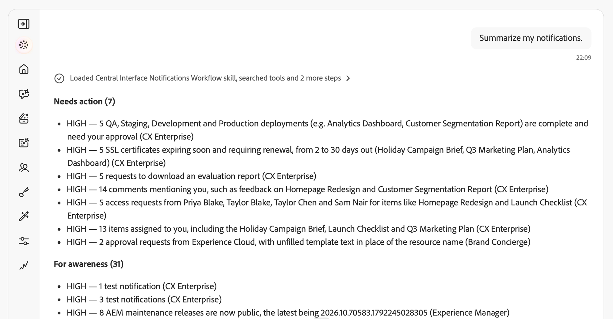

# 通知技能 {#notification-skills}

使用Adobe CX Enterprise Coworker中的“通知技能”查看通知、确定措施项并通过对话管理通知首选项。 使用您在通知面板中通过Adobe CX Enterprise应用程序收到的通知。

汇总通知，查找特定项目，并将重复通知分组为不同问题。 在其应用程序中打开通知，将其标记为已读或未读，或设置提醒。

>[!AVAILABILITY]
>
>所有有权访问Adobe CX Enterprise Coworker的客户都可以获得通知技能。 使用这些技能无需其他设置。
>
>若要在[!DNL Slack]中接收通知，贵组织必须具有连接的[!DNL Slack]工作区。

## 开始之前 {#before-you-begin}

在开始之前，请确保您具有：

* 访问Adobe CX Enterprise Coworker。
* 访问一个或多个向您发送通知的Adobe CX Enterprise应用程序。
* 您的组织的已连接[!DNL Slack]工作区（如果您希望在[!DNL Slack]中接收通知）。

## 审核并处理通知 {#review-and-act}

先从摘要开始，然后优化您的请求并根据特定通知执行操作。

1. 打开同事聊天。 有关说明，请参阅[开始使用同事聊天](/help/chat/ui-guide.md)。
1. 在&#x200B;**[!UICONTROL 询问同事内容]**&#x200B;框中输入请求，然后选择&#x200B;**[!UICONTROL 发送]**。 例如：

   *“今天需要我关注什么？”*

1. 查看需要采取行动和为提高认识而提供的通知。

   

1. 输入后续问题以缩小结果范围。 例如：

   *“通过这些通知，我应该了解Experience Platform中是否有任何失败？”*

   

1. 询问有关通知的详细信息，或在其应用程序中打开该通知以进行调查。
1. 要求将通知标记为已读或设置提醒。 例如：

   *“明天提醒我高优先级的传入事件速率警报。”*

   

继续对话，不重复先前请求的上下文。 如果您的请求可应用于多个通知、应用程序或设置，请在继续之前回答澄清问题。

您会在进行超出请求范围的更改之前收到确认请求。

## 支持的用例 {#supported-use-cases}

使用“通知技能”可查看发送给您的通知、处理通知并管理接收通知的方式。

>[!NOTE]
>
>通知技能不会发送、共享或删除通知。

### 确定措施项 {#identify-action-items}

询问您需要关注的Adobe CX Enterprise应用程序中的哪些通知。

示例提示：

* “今天有什么需要我关注的？”
* “赶紧来。”
* “有什么事等待我处理吗？”

### 总结通知 {#summarize-notifications}

请求一段时间的摘要或一个应用程序。 与为提高认识而提供的通知分开审查行动项目。 重复的通知将分组为不同的问题，而不是单独列出。

示例提示：

* “总结一下过去一周我的通知。”
* “给我一天通知的概观。”
* “概述我的Adobe Journey Optimizer通知。”

### 查找特定通知 {#find-specific-notifications}

按未读状态、审批请求、失败、错误或产品版本等条件筛选通知。

示例提示：

* “仅显示未读通知。”
* “显示我的审批请求。”
* “我是否应该了解任何严重故障警报？”
* “向我显示Experience Platform的发布通知。”

### 查看通知详细信息 {#review-notification-details}

在发送通知时询问通知的完整详细信息。 如果多个通知与您的请求匹配，请指定您的意思。

示例提示：

* “告诉我关于历程通知的更多信息。”
* “这个警示对我意味着什么？”

### 对通知执行操作 {#act-on-notifications}

在其应用程序中打开通知，将通知标记为已读或未读，或设置提醒。 选择五分钟、十五分钟、一小时或明天的提醒。

示例提示：

* “将该通知标记为已读。”
* “将该通知标记为未读。”
* “一小时后再提醒我这个通知。”
* “将我的所有通知标记为已读。”

### 管理通知偏好设置 {#manage-notification-preferences}

在更改接收通知的方式之前，请询问您当前的设置。 指定要更新的应用程序或通知类别。

| 首选项 | 可用更改 |
| --- | --- |
| 投放渠道 | 为应用程序或类别打开或关闭应用程序中的通知、电子邮件通知或[!DNL Slack]通知。 |
| 电子邮件发送频率 | 选择即时电子邮件投放或每日或每周摘要。 |
| 类别优先级 | 选择哪些通知类别具有高优先级。 |
| 弹出警报 | 选择显示弹出警报的通知类别。 |

示例提示：

* “我为Adobe Journey Optimizer设置的通知是什么？”
* “禁用Experience Platform的[!DNL Slack]通知。”
* “将我的每日摘要切换到每周。”
* &quot;将发布更新通知静音。&quot;
* “仅通过电子邮件发送Adobe Journey Optimizer通知。”

如果同事聊天请求日程安排详细信息，请指定每周摘要的日期、时间和时区。

## 有关此主题的更多帮助 {#more-help}

使用这些指南可开始同事聊天或调查Experience Platform警报活动。

* [同事聊天入门](/help/chat/ui-guide.md)
* [客户警报技能](/help/chat/use-cases/customer-alerts/customer-alerts.md)
