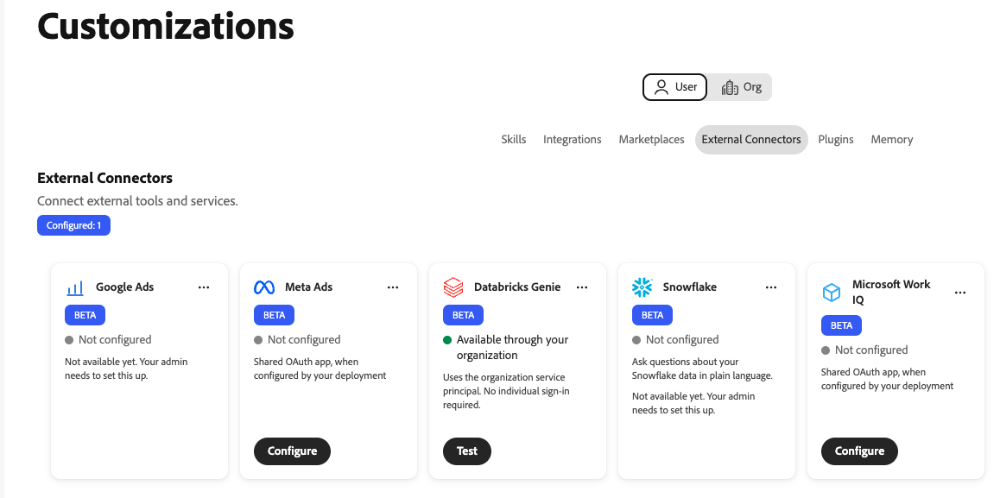
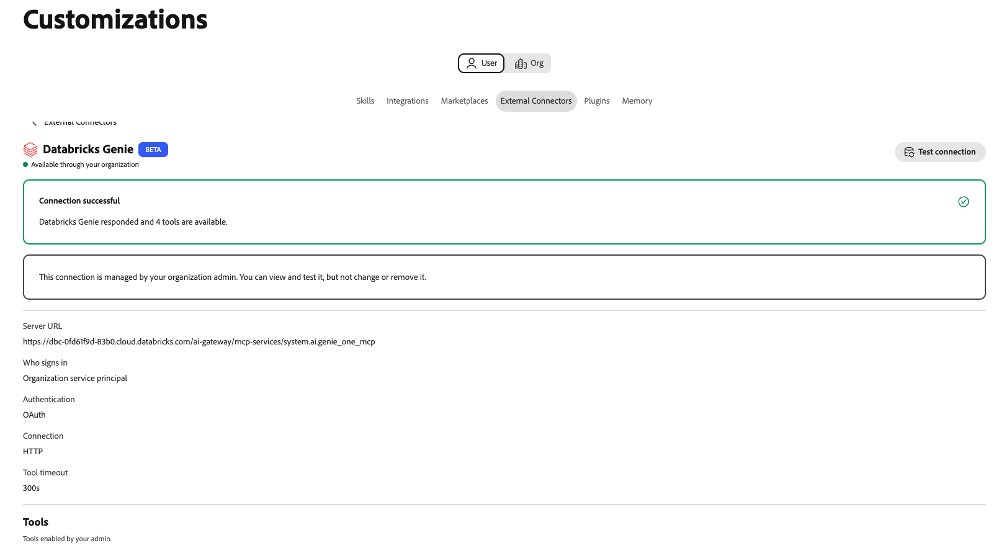

# Databricks Genie外部连接器 {#databricks-genie}

使用[!DNL Databricks Genie]外部连接器在Adobe CX Enterprise Coworker中以纯语言询问有关[!DNL Databricks]数据的问题。 [!DNL Genie]写入SQL并在聊天中返回答案。 连接器将辅助进程链接到[!DNL Databricks]工作区中的[!DNL Genie One]模型上下文协议(MCP)服务器。

>[!AVAILABILITY]
>
>[!DNL Databricks Genie]外部连接器为Beta版。 文档和功能可能会发生变化。

## 连接器配置 {#connector-configuration}

连接器配置过程分为两个部分：

* **组织设置：**&#x200B;管理员将同事连接到[!DNL Databricks]工作区，选择用户登录的方式，并选择成员可以使用的工具。
* **成员访问：**&#x200B;成员使用具有共享组织标识或他们自己的[!DNL Databricks]标识的连接，具体取决于登录选项。

管理员选择以下登录选项之一：

| 选项 | 管理员提供的内容 | 访问的工作方式 |
| --- | --- | --- |
| **[!UICONTROL 组织服务主体]** | [!DNL Databricks]服务主体的客户端ID和客户端密码。 | 所有成员都使用服务主体的权限。 成员未登录到[!DNL Databricks]。 |
| **[!UICONTROL 每个人登录]** | [!DNL Databricks] OAuth应用程序连接的客户端ID，以及可选的客户端密钥。 | 每个成员均使用自己的[!DNL Databricks]身份登录，并按照其[!DNL Databricks]权限进行访问。 |

这两个选项都不会授予所选标识尚未拥有的[!DNL Databricks]权限。 [!DNL Databricks]对每个请求强制执行[!DNL Unity Catalog]权限。

## 先决条件 {#prerequisites}

此连接器可与[!DNL Databricks Genie One]一起使用。 它不支持旧版[!DNL Genie]空间MCP URL。 若要连接其他[!DNL Databricks] MCP服务器（如[!DNL Databricks SQL]服务器），请将其单独添加为集成。

在开始之前，请确保您具备以下条件：

* **对于组织设置：**&#x200B;具有在同事中管理组织连接器的权限的帐户。
* **对于[!DNL Databricks]工作区：**&#x200B;可用[!DNL Genie One]的工作区的HTTPS URL。
* **对于服务主体选项：** [!DNL Databricks]服务主体的客户端ID和客户端密钥。
* **对于个人登录选项：** [!DNL Databricks] OAuth应用程序连接及其客户端ID。 您还需要一位可以注册同事重定向URL的[!DNL Databricks]管理员。
* **对于[!DNL Databricks]访问：** Workspace、[!DNL Genie]，以及将要使用的标识的数据权限。 同事不授予这些权限。

>[!IMPORTANT]
>
>切勿在屏幕截图、聊天或支持票证中共享客户端密钥、访问令牌或其他凭据。

有关说明，请参阅以下[!DNL Databricks]文档：

* [Genie One MCP](https://docs.databricks.com/aws/en/agents/mcp-tools/genie-mcp){target="_blank"}
* [启用或禁用合作伙伴OAuth应用程序](https://docs.databricks.com/aws/en/integrations/enable-disable-oauth){target="_blank"}
* [使用OAuth授权服务主体访问数据库](https://docs.databricks.com/aws/en/dev-tools/auth/oauth-m2m){target="_blank"}

## 为您的组织配置连接器 {#configure-organization}

管理员使[!DNL Databricks Genie]连接器对组织中的每个人可用。 组织页面上的更改适用于组织中的所有用户。 只有组织管理员可以添加此连接。 成员无法从&#x200B;**[!UICONTROL 用户]**&#x200B;视图中配置它。

1. 打开&#x200B;**[!UICONTROL 自定义项]**，选择&#x200B;**[!UICONTROL 组织]**，然后选择&#x200B;**[!UICONTROL 外部连接器]**。 在&#x200B;**[!UICONTROL Databricks Genie]**&#x200B;卡上，选择&#x200B;**[!UICONTROL 配置]**。

1. 在&#x200B;**[!UICONTROL Connect Databricks Genie]**&#x200B;对话框中，在&#x200B;**[!UICONTROL 服务器URL]**&#x200B;中输入工作区URL或[!DNL Genie One] MCP URL。 同事将源保存为以下格式：

   ```text
   https://<workspace-host>/ai-gateway/mcp-services/system.ai.genie_one_mcp
   ```

   将URL用于您自己的工作区。 Co-worker会拒绝不使用HTTPS或使用不支持路径的URL。 不支持旧版[!DNL Genie]空间URL，如`/api/2.0/mcp/genie/<space-id>`。

1. 在&#x200B;**[!UICONTROL 登录者？]**&#x200B;下，选择一个登录选项，然后完成其设置。

   {width="500" zoomable="yes"}

   * **[!UICONTROL 组织服务主体]：**&#x200B;请求使用该服务主体的权限。 使用此选项可集中管理或自动访问。 成员未登录到[!DNL Databricks]。

     | 设置 | 说明 |
     | --- | --- |
     | **[!UICONTROL 服务主体客户端ID]** | 必需。 [!DNL Databricks]服务主体的客户端ID。 要设置服务主体，请在对话框中选择&#x200B;**[!UICONTROL 如何设置服务主体OAuth]**。 |
     | **[!UICONTROL 服务主体客户端密码]** | 必需。 服务主体的客户端密码。 同事安全地存储密钥，并将其用于组织服务主体。 |

   * **[!UICONTROL 每个登录者]：**&#x200B;请求使用每个登录者的[!DNL Databricks]权限。 使用此选项可进行受管理的用户驱动访问。 每个成员都使用自己的[!DNL Databricks]身份授权应用程序。

     | 设置 | 说明 |
     | --- | --- |
     | **[!UICONTROL 重定向URL]** | 只读。 复制此URL，并在[!DNL Databricks]帐户控制台中将Co-worker注册为OAuth应用程序连接时添加此URL。 有关说明，请在对话框中选择&#x200B;**[!UICONTROL 如何添加OAuth应用程序连接]**。 不同环境之间的重定向URL不同，因此请始终从对话框中复制该URL。 |
     | **[!UICONTROL OAuth应用程序客户端ID]** | 必需。 创建应用程序连接后[!DNL Databricks]显示的客户端ID。 同事使用它向[!DNL Databricks]登录页面发送每个人。 |
     | **[!UICONTROL OAuth应用程序客户端密钥]** | 可选。 仅当您将应用程序连接创建为机密客户端时，才输入密码。 如果没有客户端密钥，应用程序将使用公共客户端配置。 |

   同事从工作区中派生出OAuth URL和范围。 身份验证类型和连接协议是固定的且只读。 按照您组织的审批流程操作OAuth应用程序及其请求的访问权限。

   >[!IMPORTANT]
   >
   >对于组织服务主体，使用此连接的每个用户都使用服务主体的权限进行操作。

1. 在&#x200B;**[!UICONTROL 用户可用的工具]**&#x200B;下，选择成员可以使用的工具。 连接器提供了以下工具，这些工具均默认可用：

   | 工具 | 描述 |
   | --- | --- |
   | `genie_ask` | 向[!DNL Genie]提问。 |
   | `genie_poll_response` | 检查仍在进行的响应的状态。 |
   | `genie_get_query_result` | 检索查询结果。 |
   | `genie_cancel_response` | 取消响应。 |

   要阻止组织中每个人的工具，请移除其标记。 同事将删除的工具另存为组织的排除项。 必须至少有一个工具保持启用状态。 删除工具后，将显示&#x200B;**[!UICONTROL 还原所有工具]**&#x200B;选项。 选择该复选框以清除排除项并使所有工具再次可用。

   {width="500" zoomable="yes"}

   成员只能查看和使用处于启用状态的工具，并且不能更改工具选择。 启用工具不会向成员授予额外的[!DNL Databricks]权限。 工具超时固定为300秒。

1. 查看&#x200B;**[!UICONTROL 访问和权限]**，然后选择&#x200B;**[!UICONTROL 保存连接]**。 **[!UICONTROL Databricks Genie]**&#x200B;卡显示已保存&#x200B;**[!UICONTROL 配置]**。

   选择&#x200B;**[!UICONTROL 查看配置]**&#x200B;以查看工作区、身份验证、启用的工具和工具超时。 然后选择&#x200B;**[!UICONTROL 测试]**&#x200B;以检查连接。

   {width="700" zoomable="yes"}

成功的测试不会确认所选身份具有所需的[!DNL Databricks]权限。

## 使用连接器作为成员 {#use-as-member}

管理员配置连接器后，从您自己的&#x200B;**[!UICONTROL 自定义项]**&#x200B;视图中将其打开。 成员可以查看和测试连接，但不能更改或删除连接。

1. 打开&#x200B;**[!UICONTROL 自定义项]**，选择&#x200B;**[!UICONTROL 用户]**，然后选择&#x200B;**[!UICONTROL 外部连接器]**。

1. 查找&#x200B;**[!UICONTROL 数据库精灵]**&#x200B;卡。 如果您的组织尚未配置连接器，则卡会显示&#x200B;**[!UICONTROL 未配置]**&#x200B;和&#x200B;**[!UICONTROL 尚不可用。 您的管理员需要设置此项。]** 成员没有&#x200B;**[!UICONTROL 配置]**&#x200B;按钮，因此请要求您的管理员[配置连接器](#configure-organization)。

1. 如果您的组织使用服务主体，则卡片显示&#x200B;**[!UICONTROL 可通过您的组织使用]**。 您无需登录。 要检查连接，请打开连接器详细信息并选择&#x200B;**[!UICONTROL 测试连接]**。

   {width="700" zoomable="yes"}

   成功的测试显示&#x200B;**[!UICONTROL 连接成功]**&#x200B;以及可用的工具数量。

   {width="700" zoomable="yes"}

1. 如果您的组织使用每人登录，则卡片显示&#x200B;**[!UICONTROL 需要登录]**。 打开连接器，开始登录，然后使用目标帐户登录到[!DNL Databricks]。 完成任何所需的单点登录(SSO)或多重身份验证(MFA)步骤。

1. 返回同事后，请确认连接器显示&#x200B;**[!UICONTROL 已连接]**。 查看管理员启用的工具，并根据需要选择&#x200B;**[!UICONTROL 测试连接]**。

成员视图是只读的。 它显示连接状态和管理员启用的工具。 您不输入组织的OAuth客户端密钥，也不更改工具选择。 如果连接失败，连接器详细信息将显示错误和技术详细信息。 复制技术详细信息并与管理员共享。

连接状态不能保证访问特定数据。 [!DNL Databricks]工作区、[!DNL Genie]和数据权限仍适用。

## 访问疑难解答 {#troubleshoot-access}

如果设置、登录或访问失败，请与管理员核对以下事项：

| 问题 | 检查内容 |
| --- | --- |
| 服务器URL被拒绝 | URL使用HTTPS，是工作区源或确切的[!DNL Genie One] MCP URL。 删除旧版[!DNL Genie]空间路径和其他不受支持的路径。 |
| OAuth登录失败或重定向URL不匹配 | [!DNL Databricks] OAuth应用程序连接具有来自同一同事环境的准确重定向URL。 客户端ID和客户端密码（如果已使用）均正确。 |
| 服务主体连接失败 | 客户端ID和客户端密钥属于预期的服务主体，客户端密钥有效，服务主体可以访问工作区。 |
| 登录成功，但[!DNL Genie]请求失败 | 成员或服务主体具有所需的工作区[!DNL Genie]和数据权限。 管理员可以查看技术详细信息和启用的工具。 |
| 成员无法查看或配置连接器 | 管理员必须先在&#x200B;**[!UICONTROL 组织]**&#x200B;视图中配置[!DNL Databricks Genie]。 成员无法创建此连接。 |
