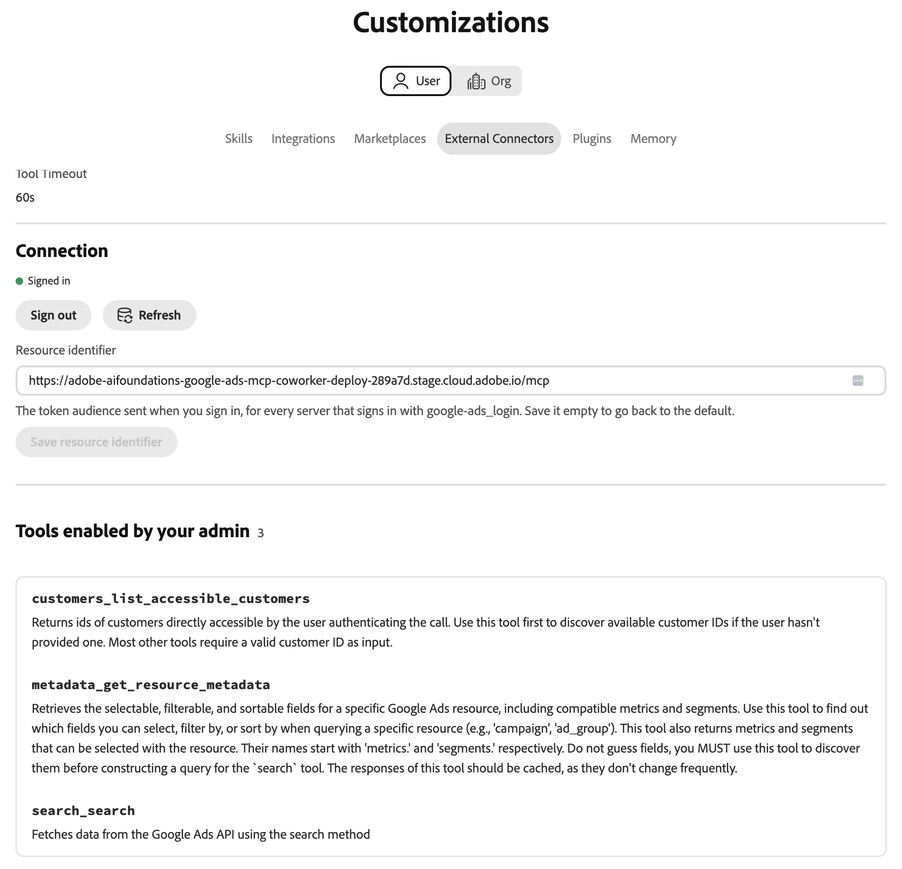

# Google Ads外部连接器 {#google-ads}

使用[!DNL Google Ads]外部连接器在Adobe CX Enterprise Coworker中处理[!DNL Google Ads]数据。 设置连接器后，请询问同事您可以访问哪些广告帐户，哪些字段和量度可用，以及营销活动的执行情况。 连接器是模型上下文协议(MCP)服务器。

>[!AVAILABILITY]
>
>[!DNL Google Ads]外部连接器为Beta版。 文档和功能可能会发生变化。

## 连接器配置 {#connector-configuration}

连接器配置过程分为两个部分：

* **组织设置：**&#x200B;管理员为整个组织配置连接器一次，并选择成员可以使用的工具。 Adobe提供OAuth应用程序，因此没有可输入的应用程序凭据。
* **成员登录：**&#x200B;每个成员使用自己的[!DNL Google]帐户登录。 成员只能访问其[!DNL Google]帐户可以访问的[!DNL Google Ads]帐户。

保存组织配置不会登录任何成员或授予[!DNL Google Ads]帐户的访问权限。 每个成员必须单独登录。

## 先决条件 {#prerequisites}

在开始之前，请确保您具备以下条件：

* **对于组织设置：**&#x200B;具有在同事中管理组织连接器的权限的帐户。
* **对于成员登录：**&#x200B;具有您计划使用的[!DNL Google Ads]帐户访问权限的[!DNL Google]帐户。

## 为您的组织配置连接器 {#configure-organization}

管理员使[!DNL Google Ads]连接器对组织中的每个人可用。 组织页面上的更改适用于组织中的所有用户。

1. 打开&#x200B;**[!UICONTROL 自定义项]**，选择&#x200B;**[!UICONTROL 组织]**，然后选择&#x200B;**[!UICONTROL 外部连接器]**。 在&#x200B;**[!UICONTROL Google广告]**&#x200B;卡上，选择&#x200B;**[!UICONTROL 配置]**。

1. 在&#x200B;**[!UICONTROL 为组织配置Google广告]**&#x200B;对话框中，确认&#x200B;**[!UICONTROL OAuth应用程序]**&#x200B;是&#x200B;**[!UICONTROL Adobe管理的OAuth应用程序]**。 Adobe提供了[!DNL Google Ads]应用，因此您无需输入应用凭据。 在&#x200B;**[!UICONTROL 用户可用的工具]**&#x200B;下，选择组织所需的工具。 有关详细信息，请参阅[可用工具](#available-tools)。 查看&#x200B;**[!UICONTROL 每个人单独登录]**&#x200B;通知，然后选择&#x200B;**[!UICONTROL 保存连接]**。

   {width="500" zoomable="yes"}

1. 查看保存的&#x200B;**[!UICONTROL google-ads]**&#x200B;连接器详细信息。

   | 设置 | 说明 |
   | --- | --- |
   | **[!UICONTROL Source]** | 环境的MCP服务器URL。 |
   | **[!UICONTROL 身份验证]** | 身份验证方法`google-ads_login`。 |
   | **[!UICONTROL 工具策略]** | 允许的刀具名称或阵列。 |
   | **[!UICONTROL Connection]** | 您自己的登录状态。 |

   {width="700" zoomable="yes"}

连接器详细信息中的&#x200B;**[!UICONTROL 连接]**&#x200B;状态是指您自己的连接，而不是与组织的连接。 每个成员仍需要使用自己的帐户登录。 成员登录后，可以选择&#x200B;**[!UICONTROL 测试]**&#x200B;来测试工具发现。 要自己使用连接器，请按照[以成员身份登录](#sign-in-as-a-member)中的步骤操作。

要停止向您的组织提供连接器，请在连接器详细信息页面上选择&#x200B;**[!UICONTROL 删除]**。

### 可用工具 {#available-tools}

[!DNL Google Ads]连接器提供了以下工具：

| 工具 | 描述 |
| --- | --- |
| `customers_list_accessible_customers` | 列出您的登录[!DNL Google]帐户可以直接访问的客户ID。 |
| `metadata_get_resource_metadata` | 查找可用于[!DNL Google Ads]资源（如营销活动或广告组）的字段、量度和区段。 |
| `search_search` | 检索[!DNL Google Ads]配置或报告数据。 |

## 以成员身份登录 {#sign-in-as-a-member}

管理员配置连接器后，每个成员均使用自己的[!DNL Google]帐户登录。

1. 打开&#x200B;**[!UICONTROL 自定义项]**，选择&#x200B;**[!UICONTROL 用户]**，然后选择&#x200B;**[!UICONTROL 外部连接器]**。 在&#x200B;**[!UICONTROL Google广告]**&#x200B;卡上，选择&#x200B;**[!UICONTROL 登录]**。

   如果卡显示&#x200B;**[!UICONTROL 未配置]**&#x200B;或连接器不可用，请要求管理员[配置连接器](#configure-organization)。

1. 在[!DNL Google] **[!UICONTROL 选择帐户]**&#x200B;屏幕上，选择有权访问您的[!DNL Google Ads]帐户的帐户，或选择&#x200B;**[!UICONTROL 使用其他帐户]**。 然后，完成贵组织所需的任何登录步骤，例如单点登录(SSO)、多重身份验证(MFA)或身份验证。

   这些步骤及其顺序取决于您的组织和帐户策略。

   {width="500" zoomable="yes"}

1. 查看所选帐户和您授权的应用，然后选择&#x200B;**[!UICONTROL 继续]**。

   [!DNL Google]将应用程序名称显示为[!DNL Adobe Experience Platform]。 如果您以前使用过该应用，[!DNL Google]会显示您正在重新登录。 首次访问的用户可能会看到不同的提示。

   {width="500" zoomable="yes"}

1. 查看访问请求，然后选择&#x200B;**[!UICONTROL 继续]**。

   {width="500" zoomable="yes"}

   >[!IMPORTANT]
   >
   >只有在您识别应用程序并且组织批准请求的访问权限时，才应继续。

1. 在[!DNL Google]将您返回到同事之后，打开&#x200B;**[!UICONTROL google-ads]**&#x200B;连接器详细信息。 确认连接器显示&#x200B;**[!UICONTROL 已连接]**&#x200B;和&#x200B;**[!UICONTROL 已登录]**。

   将&#x200B;**[!UICONTROL 资源标识符]**&#x200B;保留为默认值，除非管理员另有说明。 此字段设置登录时发送的令牌受众。 要返回到默认值，请清除该字段并选择&#x200B;**[!UICONTROL 保存资源标识符]**。

   {width="700" zoomable="yes"}

1. 选择&#x200B;**[!UICONTROL 测试]**&#x200B;以检查同事是否可以发现连接器工具。 然后查看管理员启用的&#x200B;**[!UICONTROL 工具]**&#x200B;以查看可以使用的工具。

   **[!UICONTROL 测试]**&#x200B;在您登录后可用。

   {width="700" zoomable="yes"}

若要从连接器断开您的[!DNL Google]帐户，请选择&#x200B;**[!UICONTROL 注销]**。 连接器详细信息还显示&#x200B;**[!UICONTROL 工具超时]**&#x200B;设置和&#x200B;**[!UICONTROL 刷新]**&#x200B;控件。

**[!UICONTROL 已连接]**&#x200B;状态未确认对特定广告帐户的访问权限或每个报表是否成功运行。 若要确认您的访问权限，请[检查您的广告帐户访问权限](#check-ad-account-access)。

## 检查您的广告帐户访问权限 {#check-ad-account-access}

要确认您可以使用哪些[!DNL Google Ads]帐户，请开始聊天并输入提示。

示例提示：

* “我可以访问哪些Google Ads帐户？”

同事使用`customers_list_accessible_customers`工具列出您的[!DNL Google]帐户可以直接访问的客户ID。 这是帐户访问检查，而不是性能报表。 如果您使用经理帐户，则该列表不包括其下的每个帐户。

在请求报表之前，请执行以下操作：

* 从列表中选择帐户。
* 指定具有开始日期和结束日期的日期范围。
* 要求同事查找可用于报表的字段和量度。

## 访问疑难解答 {#troubleshoot-access}

如果您无法访问您的[!DNL Google Ads]数据，请与管理员核对以下事项：

| 面积 | 检查内容 |
| --- | --- |
| [!DNL Google]帐户 | 您使用有权访问[!DNL Google Ads]帐户的[!DNL Google]帐户登录。 |
| 帐户权限 | 您的[!DNL Google]帐户对您要使用的[!DNL Google Ads]帐户具有权限。 |
| 经理帐户 | 如果您通过manager帐户访问帐户，则您的管理员已确认所需的manager帐户设置。 |
| 工具选择 | 您的管理员在&#x200B;**[!UICONTROL 用户可用的工具]**&#x200B;下启用了所需的工具。 |
| 资源标识符 | **[!UICONTROL 资源标识符]**&#x200B;使用默认值，除非管理员告诉您其他情况。 |
