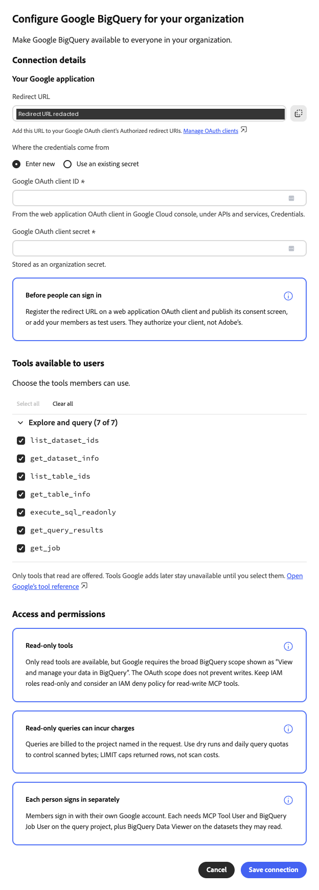
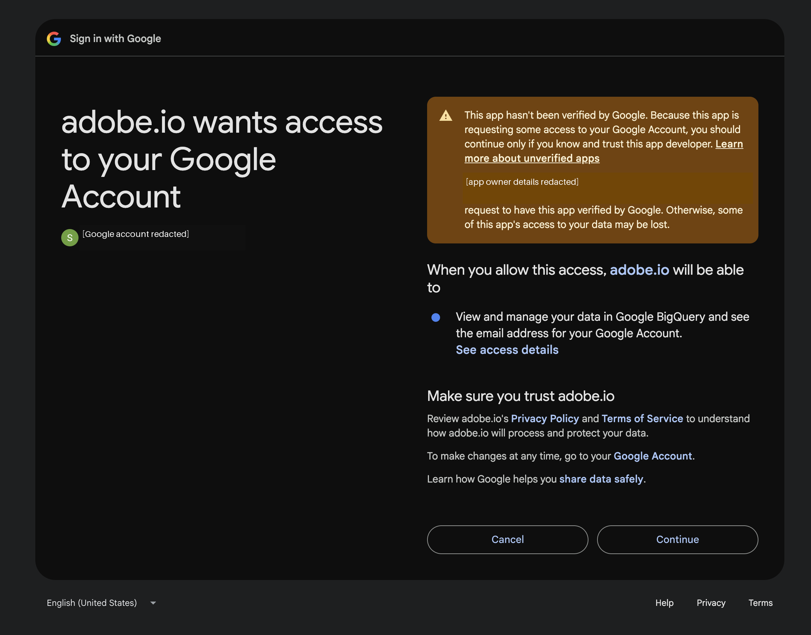
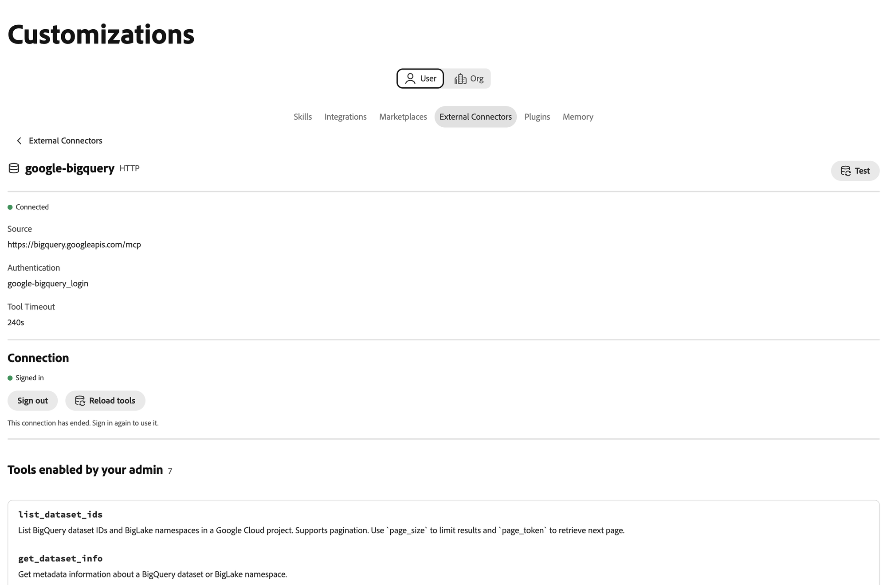

# Google BigQuery外部连接器 {#google-bigquery}

使用[!DNL Google BigQuery]外部连接器在Adobe CX Enterprise Coworker中浏览和查询您的[!DNL BigQuery]数据。 设置连接器后，要求Co-worker列出数据集和表，说明表模式，并运行只读SQL查询。 连接器是由[!DNL Google]在`https://bigquery.googleapis.com/mcp`托管的模型上下文协议(MCP)服务器。

>[!AVAILABILITY]
>
>[!DNL Google BigQuery]外部连接器为Beta版。 文档和功能可能会发生变化。

## 连接器配置 {#connector-configuration}

连接器配置过程分为三个部分：

* **[!DNL Google Cloud]准备：** [!DNL Google Cloud]管理员准备了一个查询项目，启用了[!DNL BigQuery] API，并授予成员所需的标识和访问管理(IAM)角色。
* **组织设置：**&#x200B;同事管理员为整个组织配置连接器一次。 管理员连接组织的[!DNL Google] OAuth应用程序并选择成员可以使用的工具。
* **成员登录：**&#x200B;每个成员使用自己的[!DNL Google]帐户登录。 成员只能访问其[!DNL Google]身份可访问的项目和数据集。

连接器使用您组织拥有的OAuth应用程序。 Adobe不为此连接器提供[!DNL Google] OAuth应用程序。 保存组织配置不会登录任何成员或授予[!DNL BigQuery]权限。 成功的[!DNL Google]登录也不授予数据集访问权限，因为[!DNL Google Cloud] IAM控制对您的数据的访问权限。

## 先决条件 {#prerequisites}

在开始之前，请确保您具备以下条件：

* **对于[!DNL Google Cloud]准备：**&#x200B;可在[!DNL Google Auth Platform]中启用API、授予IAM角色和创建OAuth客户端的[!DNL Google Cloud]管理员。
* **对于组织设置：**&#x200B;具有在同事中管理组织连接器的权限的帐户。 您还需要[!DNL Google] OAuth Web应用程序客户端的客户端ID和客户端密钥，或包含它们的现有组织密钥。
* **对于成员登录：** OAuth应用程序受众允许并具有所需IAM角色的[!DNL Google]标识。

了解查询项目的ID以及成员应读取的数据集。 查询项目运行查询作业并为其付费。 数据可以存放在不同的项目中，并且OAuth客户端也可以属于不同的项目。 对于试点，一个项目可以包含OAuth客户端、查询作业和数据集。

## 准备[!DNL Google Cloud] {#prepare-google-cloud}

在同事中配置连接器之前，请在[!DNL Google Cloud]中准备您的项目和成员访问权限。 创建OAuth应用程序和授予数据访问权限是两个不同的任务。 使用连接器的成员无需权限即可编辑OAuth应用程序。

### 准备查询项目 {#prepare-query-project}

[!DNL Google Cloud]管理员准备运行查询作业的项目：

1. 在[Google Cloud Console](https://console.cloud.google.com/)中，选择或创建一个项目。
1. 启用[!DNL BigQuery] API（如果尚未启用）。 启用API还会启用[!DNL BigQuery]远程MCP服务器。
1. 选择帐单或[BigQuery沙盒](https://docs.cloud.google.com/bigquery/docs/sandbox)，然后在查询项目上设置适当的每日[自定义查询配额](https://docs.cloud.google.com/bigquery/docs/custom-quotas)。

>[!IMPORTANT]
>
>只读查询仍会产生费用。 [!DNL BigQuery]成本取决于查询扫描的字节数，而不是它返回的行数。 `LIMIT`子句控制返回的行，但通常不会减少扫描的字节。 使用试运行、显式列、分区过滤器和每日查询配额来控制成本。

有关详细信息，请参阅[!DNL Google Cloud]文档中的[使用BigQuery远程MCP服务器](https://docs.cloud.google.com/bigquery/docs/use-bigquery-mcp)。

### 授予IAM角色 {#grant-iam-roles}

将以下角色授予成员的[!DNL Google]标识。 尽可能使用托管组，并首选数据集级别的数据访问。

| 角色 | 在何处授予 | 用途 |
| --- | --- | --- |
| [!UICONTROL MCP工具用户] (`roles/mcp.toolUser`) | 用于MCP调用的项目 | 进行MCP工具调用。 |
| [!UICONTROL BigQuery作业用户] (`roles/bigquery.jobUser`) | 查询项目 | 运行查询作业。 |
| [!UICONTROL BigQuery数据查看器] (`roles/bigquery.dataViewer`) | 授权的数据集或数据项目 | 读取数据和元数据。 |

请勿仅授予[!UICONTROL BigQuery数据编辑器]、[!UICONTROL BigQuery数据所有者]或[!UICONTROL BigQuery管理员]使用此只读连接器。 作为附加保护，请考虑针对读写MCP工具[&#128279;](https://docs.cloud.google.com/mcp/prevent-read-write-tool-use)的拒绝策略。 要求您的[!DNL Google Cloud]管理员首先查看拒绝策略的范围，因为它可能会影响其他[!DNL Google]个MCP客户端和服务。 有关详细信息，请参阅[BigQuery IAM角色和权限](https://docs.cloud.google.com/bigquery/docs/access-control)。

## 为您的组织配置连接器 {#configure-organization}

管理员使[!DNL Google BigQuery]连接器对组织中的每个人可用。 组织页面上的更改适用于组织中的所有用户。

1. 打开&#x200B;**[!UICONTROL 自定义项]**，选择&#x200B;**[!UICONTROL 组织]**，然后选择&#x200B;**[!UICONTROL 外部连接器]**。 在&#x200B;**[!UICONTROL Google BigQuery]**&#x200B;卡上，选择&#x200B;**[!UICONTROL 配置]**。

   如果连接器已配置，则卡会显示&#x200B;**[!UICONTROL 查看配置]**。

1. 在&#x200B;**[!UICONTROL 为您的组织配置Google BigQuery]**&#x200B;对话框中，复制&#x200B;**[!UICONTROL 您的Google应用程序]**&#x200B;下的&#x200B;**[!UICONTROL 重定向URL]**。

   由于重定向URL在环境和区域之间有所不同，因此请始终从对话框中复制准确的值。 请勿在浏览器中使用协作页的URL或[!DNL BigQuery] MCP服务器URL。 如果一个OAuth客户端提供多个环境，请单独注册每个所需的重定向URL。

1. 在[Google身份验证平台](https://console.cloud.google.com/auth/overview)中，准备组织的OAuth客户端：

   1. 配置&#x200B;**[!UICONTROL 品牌]**&#x200B;和&#x200B;**[!UICONTROL 受众]**。 对于测试中的外部应用程序，将预期成员添加为测试用户。 在更广泛使用之前完成[!DNL Google]的发布和验证要求。
   1. 在&#x200B;**[!UICONTROL 数据访问]**&#x200B;中，添加`https://www.googleapis.com/auth/bigquery`作用域。
   1. 在&#x200B;**[!UICONTROL 客户端]**&#x200B;下，创建或选择具有&#x200B;**[!UICONTROL Web应用程序]**&#x200B;应用程序类型的OAuth客户端。
   1. 添加您复制到&#x200B;**[!UICONTROL 授权的重定向URI]**&#x200B;的重定向URL。
   1. 通过贵组织的批准密钥处理过程获取&#x200B;**[!UICONTROL 客户端ID]**&#x200B;和&#x200B;**[!UICONTROL 客户端密钥]**。

   成员授权您组织拥有的此应用程序，而不是Adobe提供的应用程序。 对屏幕截图、聊天和文档保密。

1. 在&#x200B;**[!UICONTROL 凭据来自]**&#x200B;下，选择以下选项之一：

   * **[!UICONTROL 输入新的]：**&#x200B;输入&#x200B;**[!UICONTROL Google OAuth客户端ID]**&#x200B;和&#x200B;**[!UICONTROL Google OAuth客户端密钥]**。 同事将您输入的值存储为组织密钥。
   * **[!UICONTROL 使用现有密钥]：** Select包含客户端ID和客户端密钥的已保存组织密钥。

   请勿对组织连接器使用个人密钥。

   {width="500" zoomable="yes"}

1. 展开&#x200B;**[!UICONTROL 浏览和查询]**&#x200B;工具组。 保持所有七种工具都处于选中状态，或者仅选择成员所需的工具。 必须至少选择一个工具。 有关详细信息，请参阅[可用工具](#available-tools)。

   查看&#x200B;**[!UICONTROL 访问和权限]**&#x200B;下的通知：

   * **[!UICONTROL 只读工具]：** OAuth范围很广，不会自行阻止更改。 将成员的IAM角色保持只读。
   * **[!UICONTROL 只读查询可能会产生费用]：**&#x200B;使用练习和查询配额。 `LIMIT`子句控制返回的行，不一定是扫描的字节。
   * **[!UICONTROL 每个人员单独登录]：**&#x200B;每个成员都需要必需的IAM角色。

   Select **[!UICONTROL 保存连接]**。 组织信息卡显示&#x200B;**[!UICONTROL 已保存的配置]**&#x200B;和&#x200B;**[!UICONTROL 查看配置]**。

保存配置不会将您或任何成员登录到[!DNL Google]。 保存也不会确认任何人都可以查询数据集。 要自己使用连接器，请按照[以成员身份登录](#sign-in-as-a-member)中的步骤操作。

### 可用工具 {#available-tools}

[!DNL Google BigQuery]连接器提供了以下只读工具：

| 工具 | 描述 |
| --- | --- |
| `list_dataset_ids` | 列出指定项目中的数据集。 |
| `get_dataset_info` | 读取数据集的元数据。 |
| `list_table_ids` | 列出数据集中的表和视图。 |
| `get_table_info` | 读取表的架构和元数据。 |
| `execute_sql_readonly` | 运行只读SQL查询，或试运行以估计查询扫描的字节数。 |
| `get_query_results` | 检索查询的结果，或检查长时间运行的查询。 |
| `get_job` | 检查查询作业的状态、错误和统计信息。 |

对于查询工作流，请同时选择`execute_sql_readonly`、`get_query_results`和`get_job`，以便同事可以执行长时间运行的查询作业。 同事未从[!DNL BigQuery] MCP服务器提供`execute_sql`和`cancel_job`工具。 不会自动启用[!DNL Google]以后添加到服务器的工具。 有关工具详细信息，请参阅[BigQuery MCP引用](https://docs.cloud.google.com/bigquery/docs/reference/mcp)。

在使用工具时，请考虑以下限制：

* [!DNL Google]为查询结果记录了3,000行的限制，默认查询超时为3分钟。 请勿使用连接器导出完整的表。
* 工具无法列出项目。 在您的请求中提供已知的项目ID。
* 只读SQL不支持更改[!DNL Google Drive]外部表上的数据或资源的语句，也不支持查询。
* 查询结果、架构、数据集访问列表和SQL可以出现在聊天中。 确保访问遵循贵组织的数据处理策略。

## 以成员身份登录 {#sign-in-as-a-member}

管理员配置连接器后，每个成员均使用自己的[!DNL Google]帐户登录。 您不需要OAuth客户端密钥即可登录。

1. 打开&#x200B;**[!UICONTROL 自定义项]**，选择&#x200B;**[!UICONTROL 用户]**，然后选择&#x200B;**[!UICONTROL 外部连接器]**。 在&#x200B;**[!UICONTROL Google BigQuery]**&#x200B;卡（显示&#x200B;**[!UICONTROL 未登录]**）上，选择&#x200B;**[!UICONTROL 登录]**。

   如果卡上写着管理员需要设置连接器，请要求管理员[配置连接器](#configure-organization)。

1. 在[!DNL Google] **[!UICONTROL 选择帐户]**&#x200B;屏幕上，选择具有所需IAM访问权限的帐户，或选择&#x200B;**[!UICONTROL 使用其他帐户]**。 然后，完成贵组织所需的任何登录步骤，例如单点登录(SSO)或多重身份验证(MFA)。

   此帐户可能与您用于同事的帐户不同。

   {width="500" zoomable="yes"}

1. 如果[!DNL Google]显示&#x200B;**[!UICONTROL Google尚未验证此应用]**，请与管理员确认该应用及其所有者。 仅当您的测试应用程序组织策略允许时，才继续。 否则，请选择&#x200B;**[!UICONTROL 返回安全状态]**，并要求应用程序所有者解决受众、发布或验证要求。

   {width="500" zoomable="yes"}

   在同意屏幕上查看应用程序名称和请求的访问权限。 然后选择&#x200B;**[!UICONTROL 继续]**&#x200B;以完成[!DNL Google]同意流程。

   [!DNL Google]请求权限以查看和管理您的[!DNL BigQuery]数据，并查看[!DNL Google]帐户的电子邮件地址。 这是标准的[!DNL BigQuery]范围，即使同事仅提供只读工具。

   在屏幕截图中，该应用程序名为adobe.io。 您组织的应用程序会显示其自身的名称。 此名称并不表示Adobe提供OAuth应用程序。

   >[!IMPORTANT]
   >
   >只有在您识别应用程序并且组织批准请求的访问权限时，才应继续。

   {width="500" zoomable="yes"}

1. 返回到同事，然后在连接器详细信息中查看管理员启用的&#x200B;**[!UICONTROL 工具]**。 成员可以查看工具，但不能更改工具选择。 要检查连接，请选择&#x200B;**[!UICONTROL 测试]**。

   {width="700" zoomable="yes"}

成功的登录、测试或工具列表不会确认您是否可以查询特定数据集。 若要确认您的访问权限，[请检查您的BigQuery访问权限](#check-bigquery-access)。 如果同事指出连接已结束，请重新登录。

## 检查您的[!DNL BigQuery]访问权限 {#check-bigquery-access}

要确认您可以读取数据，请启动新的聊天并输入只读提示。 将占位符替换为[!DNL Google]身份可以访问的项目和表。

示例提示：

* “列出项目`YOUR_PROJECT_ID`中的数据集。”
* “将`YOUR_QUERY_PROJECT_ID`用于查询作业，检查`YOUR_DATA_PROJECT.YOUR_DATASET.YOUR_TABLE`的架构，通过试运行估计扫描结果，然后返回聚合摘要。”

确认结果中包括所需的数据集或数据。 与原始表内容的请求相比，首选显式列、聚合和分区筛选器。 在请求中命名项目不会更改您的登录身份或授予您对该项目的访问权限。

## 访问疑难解答 {#troubleshoot-access}

如果登录或访问失败，请与管理员核对以下事项：

| 问题 | 检查内容 |
| --- | --- |
| 卡上写着连接器未配置，或者管理员需要设置连接器 | 已为您的活动组织保存组织配置。 |
| `redirect_uri_mismatch` | 已在Web应用程序客户端上的&#x200B;**[!UICONTROL 授权重定向URI]**&#x200B;中注册了来自同事对话框的确切&#x200B;**[!UICONTROL 重定向URL]**。 |
| `invalid_client` | 客户端ID和客户端密钥属于Web应用程序客户端，并且所选组织密钥正确。 |
| `access_denied`，或[!DNL Google]尚未验证应用的警告 | 应用程序所有者检查受众、测试用户资格和验证状态。 不要批准您不认识的应用程序。 |
| 连接已结束，或令牌已过期 | 再次以成员身份登录。 |
| `mcp.tools.call`的权限被拒绝 | [!UICONTROL MCP工具用户]角色以及适用的任何IAM拒绝策略。 |
| `bigquery.jobs.create`的权限被拒绝 | 查询项目上的[!UICONTROL BigQuery作业用户]角色。 |
| 表的访问被拒绝 | 数据集上的[!UICONTROL BigQuery数据查看器]角色，以及您登录的[!DNL Google]帐户。 |
| `SERVICE_DISABLED` | 在错误标识的项目中启用了[!DNL BigQuery] API。 |
| 超出每日查询配额 | 与项目管理员一起查询项目的配额。 |
| 插入、更新、删除、创建或删除数据的请求失败 | 连接器是只读的，不支持对数据或资源进行更改。 |

当您联系支持人员时，请勿共享客户端密钥、访问令牌、授权代码或客户数据。
