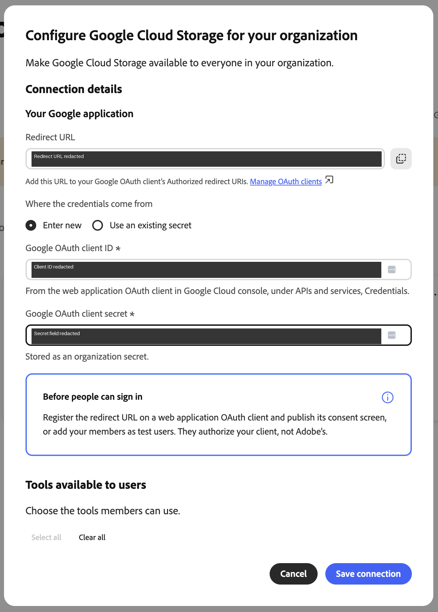
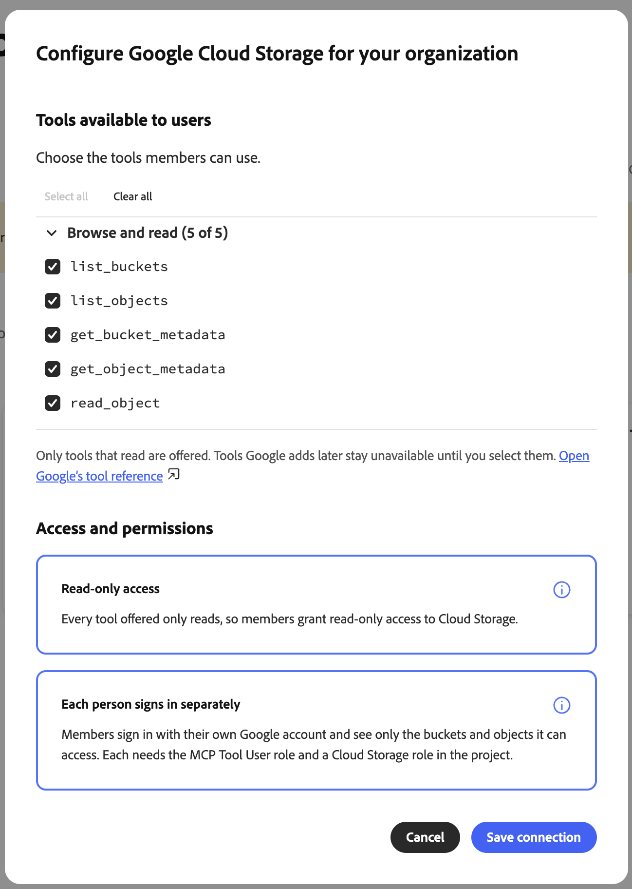
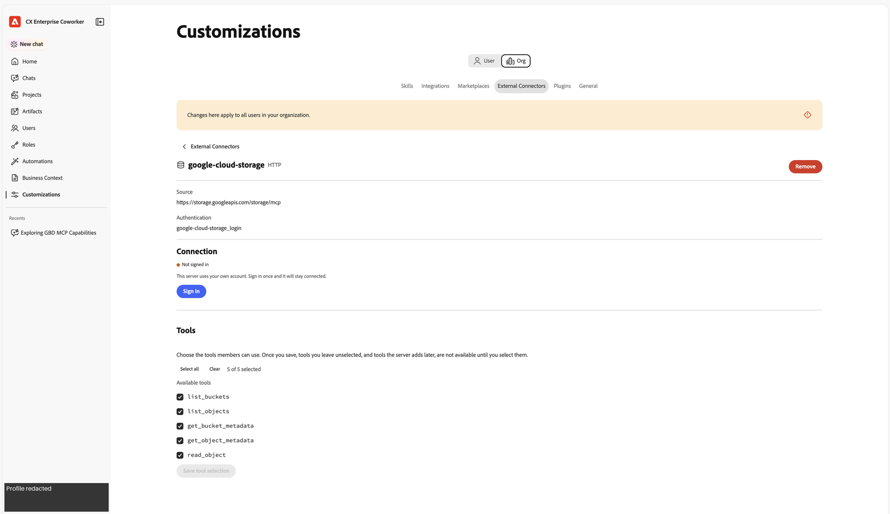

# Google Cloud Storage外部连接器 {#google-cloud-storage}

使用[!DNL Google Cloud Storage]外部连接器读取Adobe CX Enterprise Coworker中的[!DNL Cloud Storage]数据。 设置连接器后，要求同事在已知项目中列出存储段，按前缀列出对象，检查存储段和对象元数据，并读取已批准的文件。 连接器是由[!DNL Google]托管的模型上下文协议(MCP)服务器。

>[!AVAILABILITY]
>
>[!DNL Google Cloud Storage]外部连接器为Beta版。 文档和功能可能会发生变化。

## 连接器配置 {#connector-configuration}

连接器配置过程分为三个部分：

* **[!DNL Google Cloud]准备：** [!DNL Google Cloud]管理员为成员准备帐单、[!DNL Cloud Storage] API以及身份和访问管理(IAM)角色。 管理员还准备了您的组织拥有的OAuth客户端。
* **组织设置：**&#x200B;同事管理员为整个组织配置连接器一次。 管理员注册Co-worker重定向URL，输入OAuth客户端凭据，并选择成员可以使用的工具。
* **成员登录：**&#x200B;每个成员使用自己的[!DNL Google]帐户登录。 成员只能访问[!DNL Google Cloud] IAM为其帐户允许的存储桶和对象。

连接器是只读的。 它请求`https://www.googleapis.com/auth/devstorage.read_only`作用域并仅提供读取工具。 您的组织提供自己的[!DNL Google] OAuth应用程序。 此连接器没有Adobe管理的OAuth应用程序。

保存组织配置不会登录任何成员或授予[!DNL Cloud Storage]权限。 每个成员都必须已具有所需的IAM访问权限，并且必须单独登录。

## 先决条件 {#prerequisites}

在开始之前，请确保您具备以下条件：

* **对于[!DNL Google Cloud]准备：**&#x200B;启用了[!DNL Cloud Storage] API的计费项目、包含已批准数据的存储桶、成员的IAM授权以及&#x200B;**[!UICONTROL Web应用程序]**&#x200B;类型的[!DNL Google] OAuth客户端。
* **对于组织设置：**&#x200B;具有在同事中管理组织连接器的权限的帐户。 您还需要OAuth客户端ID和客户端密钥，或包含它们的现有组织密钥。
* **对于成员登录：** OAuth应用程序受众和[!DNL Google Cloud] IAM都允许的[!DNL Google]帐户。

了解项目ID和成员计划读取的分段。 连接器没有用于列出项目的工具。 OAuth客户端可以属于存储段以外的其他项目。

## 准备Google Cloud {#prepare-google-cloud}

在Co-worker中配置连接器之前，请准备[!DNL Google Cloud]项目和成员访问权限。 成功的[!DNL Google]登录不会授予存储权限。

### 准备项目和IAM {#prepare-project-iam}

[!DNL Google Cloud]管理员完成以下步骤：

1. Select或在[Google Cloud Console](https://console.cloud.google.com/)中创建项目。
1. 链接每个包含分段的项目的计费帐户。

   只读访问权限不是免费的。 存储、操作、检索和网络费用仍然适用。 有关详细信息，请参阅[云存储定价](https://cloud.google.com/storage/pricing)。

1. 在每个相关项目中启用&#x200B;**[!UICONTROL 云存储API]**。 如果OAuth客户端属于另一个项目，则也在该项目中启用API。
1. 在下表中为成员授予权限最低的角色。 与单个帐户相比，更倾向于使用受管理的组。

| 角色 | 授予位置 | 用途 |
| --- | --- | --- |
| [!UICONTROL MCP工具用户] (`roles/mcp.toolUser`) | 用于MCP调用的项目 | 进行MCP工具调用(`mcp.tools.call`)。 |
| [!UICONTROL 存储段查看器] (`roles/storage.bucketViewer`)或自定义只读角色 | 包含分段的项目 | 列出存储段和读取存储段元数据（`storage.buckets.list`和`storage.buckets.get`）。 |
| [!UICONTROL 存储对象查看器] (`roles/storage.objectViewer`) | 每个授权存储桶，或项目（如果成员可以读取其所有存储桶） | 列出对象、读取对象元数据和读取对象内容（`storage.objects.list`和`storage.objects.get`）。 |

不要仅将[!UICONTROL 存储管理员]授予列表存储段。 没有列出存储桶权限的成员在提供其名称时，仍可读取授权存储桶。 有关详细信息，请参阅[!DNL Google Cloud]文档中的[Cloud Storage IAM角色](https://docs.cloud.google.com/storage/docs/access-control/iam-roles)。

[!DNL Google]还提供可选的IAM拒绝策略，该策略阻止其他MCP客户端的读写MCP工具。 Co-worker连接器已使用只读工具选择和只读范围。 在应用策略之前，请与[!DNL Google Cloud]管理员一起查看项目范围的影响。 有关详细信息，请参阅[禁止读写MCP工具使用](https://docs.cloud.google.com/mcp/prevent-read-write-tool-use)。

### 连接设置 {#connection-settings}

Co-worker使用以下连接设置。 请不要在“设置”对话框中输入这些值。

| 设置 | 值 |
| --- | --- |
| MCP服务器URL | `https://storage.googleapis.com/storage/mcp` （仅全局终结点） |
| 传输 | 可流式处理HTTP |
| 授权服务器 | `https://accounts.google.com/` |
| 请求的范围 | `https://www.googleapis.com/auth/devstorage.read_only` |

有关详细信息，请参阅[!DNL Google Cloud]文档中的[使用Cloud Storage远程MCP服务器](https://docs.cloud.google.com/storage/docs/use-cloud-storage-mcp)和[向Google MCP服务器进行身份验证](https://docs.cloud.google.com/mcp/authenticate-mcp)。

## 为您的组织配置连接器 {#configure-organization}

管理员使[!DNL Google Cloud Storage]连接器对组织中的每个人可用。 组织页面上的更改适用于组织中的所有成员。

1. 打开&#x200B;**[!UICONTROL 自定义项]**，选择&#x200B;**[!UICONTROL 组织]**，然后选择&#x200B;**[!UICONTROL 外部连接器]**。 在&#x200B;**[!UICONTROL Google Cloud Storage]**&#x200B;信息卡上，选择&#x200B;**[!UICONTROL 配置]**。

   如果连接器已配置，请打开其保存的配置。

1. 在&#x200B;**[!UICONTROL 为组织配置Google云存储]**&#x200B;对话框中，在&#x200B;**[!UICONTROL 您的Google应用程序]**&#x200B;下，复制完整的&#x200B;**[!UICONTROL 重定向URL]**。

   重定向URL因环境和地区而异。 始终从对话框中复制精确值。 请勿在浏览器中使用同事页面的URL、MCP服务器URL或其他环境中的重定向URL。

1. 在[Google身份验证平台](https://console.cloud.google.com/auth/overview)中为您的组织准备OAuth客户端：

   1. 为您的组织配置&#x200B;**[!UICONTROL 品牌]**&#x200B;和&#x200B;**[!UICONTROL 受众]**。 对于测试中的外部应用程序，将预期成员添加为测试用户。 请先完成适用的[!DNL Google]发布和验证要求，然后再进行更广泛的使用。
   1. 在&#x200B;**[!UICONTROL 数据访问]**&#x200B;中，包括`https://www.googleapis.com/auth/devstorage.read_only`作用域。 连接器不需要读写或完全控制范围。
   1. 在&#x200B;**[!UICONTROL 客户端]**&#x200B;下，创建或选择应用程序类型&#x200B;**[!UICONTROL 设置为**[!UICONTROL  Web应用程序&#x200B;]**的OAuth客户端。]**
   1. 添加您复制到&#x200B;**[!UICONTROL 授权的重定向URI]**&#x200B;的重定向URL。 如果一个客户端提供多个环境，请注册每个环境的重定向URL。
   1. 通过贵组织的批准密钥处理过程获取&#x200B;**[!UICONTROL 客户端ID]**&#x200B;和&#x200B;**[!UICONTROL 客户端密钥]**。

   成员授权您组织拥有的此OAuth应用程序。 将凭据排除在聊天、票证和文档之外。

1. 在&#x200B;**[!UICONTROL 凭据来自]**&#x200B;下，选择以下选项之一：

   * **[!UICONTROL 输入新的]：**&#x200B;输入&#x200B;**[!UICONTROL Google OAuth客户端ID]**&#x200B;和&#x200B;**[!UICONTROL Google OAuth客户端密钥]**。 同事将您输入的值存储为组织密钥。
   * **[!UICONTROL 使用现有密钥]：** Select保存的组织密钥，其中包含客户端ID和客户端密钥。

   请勿对组织连接器使用个人密钥。

   {width="500" zoomable="yes"}

1. 展开&#x200B;**[!UICONTROL 浏览并读取（第5个，共5个）]**。 保持选择所有五个工具，或仅选择成员需要的工具。 必须至少选择一个工具。 有关详细信息，请参阅[可用工具](#available-tools)。

   在&#x200B;**[!UICONTROL 访问和权限]**&#x200B;下，查看&#x200B;**[!UICONTROL 只读访问]**&#x200B;和&#x200B;**[!UICONTROL 每个人单独登录]**&#x200B;通知。 然后选择&#x200B;**[!UICONTROL 保存连接]**。

   {width="500" zoomable="yes"}

1. 查看保存的&#x200B;**[!UICONTROL google-cloud-storage]**&#x200B;连接器详细信息。

   | 设置 | 说明 |
   | --- | --- |
   | **[!UICONTROL Source]** | MCP服务器URL `https://storage.googleapis.com/storage/mcp`。 |
   | **[!UICONTROL 身份验证]** | 身份验证方法`google-cloud-storage_login`。 |
   | **[!UICONTROL Connection]** | 您自己的登录状态。 |
   | **[!UICONTROL 工具]** | 为成员选择的工具，具有&#x200B;**[!UICONTROL Select all]**&#x200B;和&#x200B;**[!UICONTROL Clear]**&#x200B;控件以及所选工具的计数。 |

   {width="700" zoomable="yes"}

连接器详细信息中的&#x200B;**[!UICONTROL 未登录]**&#x200B;状态是指您自己的连接，而不是与组织的连接。 保存组织设置不会登录您或任何成员，也不会确认对存储段的访问权限。 要自己使用连接器，请按照[以成员身份登录](#sign-in-as-a-member)中的步骤操作。

若要更改成员以后可用的工具，请更新连接器详细信息页面上的选择，然后选择&#x200B;**[!UICONTROL 保存工具选择]**。 成员无法更改工具选择。

要停止向您的组织提供连接器，请在连接器详细信息页面上选择&#x200B;**[!UICONTROL 删除]**。

### 可用工具 {#available-tools}

[!DNL Google Cloud Storage]连接器在&#x200B;**[!UICONTROL 浏览和读取]**&#x200B;组中提供以下只读工具：

| 工具 | 描述 | 所需权限 |
| --- | --- | --- |
| `list_buckets` | 在已知[!DNL Google Cloud]项目中列出存储段，并使用前缀过滤和分页。 | 项目上的`storage.buckets.list` |
| `list_objects` | 列出授权存储段中的对象和前缀。 默认情况下，列表不递归。 | 存储桶上的`storage.objects.list` |
| `get_bucket_metadata` | 读取存储段配置，如位置、存储类、保留和版本控制。 | `storage.buckets.get` |
| `get_object_metadata` | 读取对象大小、内容类型、时间戳、层代和自定义元数据。 | `storage.objects.get` |
| `read_object` | 读取文本或支持的二进制内容，每个对象高达8 MiB。 | `storage.objects.get` |

每次工具调用还需要`mcp.tools.call`权限，通常通过相关项目上的[!UICONTROL MCP工具用户]角色进行。

连接器不提供已弃用的`read_text`工具或`write_text`、`create_bucket`、`delete_object`和`delete_bucket`工具。 没有启用写入工具的选项。 [!DNL Google]以后添加到服务器的工具不会自动变为可用，即使您选择了全部五个工具也是如此。

## 以成员身份登录 {#sign-in-as-a-member}

管理员配置连接器后，每个成员均使用自己的[!DNL Google]帐户登录。 您不需要OAuth客户端密钥即可登录。

1. 打开&#x200B;**[!UICONTROL 自定义项]**，选择&#x200B;**[!UICONTROL 用户]**，然后选择&#x200B;**[!UICONTROL 外部连接器]**。 在&#x200B;**[!UICONTROL Google Cloud Storage]**&#x200B;信息卡上，选择&#x200B;**[!UICONTROL 登录]**。

   登录之前，卡片显示&#x200B;**[!UICONTROL 未登录]**。 如果卡片显示&#x200B;**[!UICONTROL 未配置]**，请要求您的管理员[配置连接器](#configure-organization)。

1. 在[!DNL Google] **[!UICONTROL 选择帐户]**&#x200B;屏幕上，选择具有所需IAM访问权限的帐户，或选择&#x200B;**[!UICONTROL 使用其他帐户]**。 完成贵组织所需的任何登录步骤，例如单点登录(SSO)或多重身份验证(MFA)。

   此帐户可能与您用于同事的帐户不同。

   {width="500" zoomable="yes"}

1. 如果[!DNL Google]显示&#x200B;**[!UICONTROL Google尚未验证此应用]**，请与管理员确认该应用及其所有者。

   如果您的组织批准使用此应用，请选择&#x200B;**[!UICONTROL 继续]**。 否则，请选择&#x200B;**[!UICONTROL 返回安全状态]**，并要求应用程序所有者解决受众、发布或验证要求。

   {width="500" zoomable="yes"}

   在同意屏幕上查看应用程序名称和请求的访问，然后选择&#x200B;**[!UICONTROL 继续]**。 连接器请求&#x200B;**[!UICONTROL 在Google云存储中查看您的数据]**，这与只读范围匹配。

   在屏幕截图中，该应用程序名为adobe.io。 您组织的应用程序会显示其自身的名称。 此名称并不表示Adobe提供OAuth应用程序。

   >[!IMPORTANT]
   >
   >只有在您识别应用程序并且组织批准请求的访问权限时，才应继续。

   {width="500" zoomable="yes"}

1. 返回同事并确认登录已完成。 在连接器详细信息中查看&#x200B;**[!UICONTROL 管理员启用的工具]**。 您只能使用管理员启用的工具。

如果连接结束或会话过期，请重新登录。 管理员登录时，其他成员未登录。

## 检查存储段访问权限 {#check-bucket-access}

成功的登录或工具列表不会确认您是否可以访问特定存储桶。 [!DNL Google]不需要身份验证即可列出服务器工具。 要确认您的访问权限，请启动新聊天并输入只读提示。 将占位符替换为已批准的资源。

示例提示：

* “列出项目`YOUR_PROJECT_ID`中的存储桶。”
* “在存储段`YOUR_BUCKET`中列出`reports/`下最多25个对象。 检查`reports/example.txt`的大小和内容类型，然后读取其前4096字节并汇总它们。”

确认结果中包含所需的存储段或对象。 若要以嵌套前缀列出对象，请显式要求递归列表。 在读取对象之前检查对象元数据。

## 限制和数据处理 {#limits-data-handling}

在使用连接器时，请牢记以下限制和数据处理注意事项：

* **项目ID：**&#x200B;在您的请求中提供项目ID。 连接器无法列出项目。
* **前缀：**&#x200B;对象前缀是文本名称，而不是真正的文件夹。 默认情况下，列表不递归，将在页面中返回结果。
* **页面大小：**&#x200B;列表页面最多可包含1,000个项目。 使用较小的页面大小（如25到100）和窄的前缀。
* **对象大小：**&#x200B;读取的最大对象大小为8 MiB。 仅读取较大对象的一部分不会绕过此限制。 对二进制文件的支持取决于模型和客户端。
* **成本和配额：**&#x200B;可以收取存储、请求、检索和网络费用。 [!DNL Google]还向MCP服务器应用配额。 有关详细信息，请参阅[云存储MCP配额](https://docs.cloud.google.com/storage/quotas#gcs-mcp)。
* **数据处理：**&#x200B;对象内容、名称和自定义元数据进入与同事的对话。 仅使用已批准的数据。
* **审核日志：** [!DNL Cloud Storage]读取仅在启用适用的数据访问日志时显示在[!DNL Cloud Audit Logs]中。

连接器无法上传、覆盖、创建或删除文件或存储段。 它也不能将摘要保存到[!DNL Cloud Storage]。

## 访问疑难解答 {#troubleshoot-access}

如果登录或访问失败，请与管理员核对以下事项：

| 问题 | 检查内容 |
| --- | --- |
| 卡片显示&#x200B;**[!UICONTROL 未配置]** | 保存活动组织的组织连接。 |
| `redirect_uri_mismatch` | 从&#x200B;**[!UICONTROL Web应用程序]** OAuth客户端上的Co-worker对话框中注册确切的&#x200B;**[!UICONTROL 重定向URL]**。 |
| `invalid_client` | 检查客户端类型、客户端ID和客户端密钥，以及选定的组织密钥。 |
| `access_denied`或未验证的应用警告 | 与应用程序所有者一起检查应用程序受众、测试用户资格和验证状态。 不批准未知应用程序。 |
| HTTP 401，或您的会话已结束 | 再次登录。 |
| `mcp.tools.call`被拒绝 | 检查[!UICONTROL MCP工具用户]角色和任何适用的IAM拒绝策略。 |
| 存储段列表被拒绝，但已知存储段是可读的 | 检查项目的`storage.buckets.list`权限。 仅对象权限不允许您在项目中列出存储段。 |
| 存储段元数据被拒绝 | 检查`storage.buckets.get`权限。 |
| 对象列表或读取被拒绝 | 检查存储桶上的[!UICONTROL 存储对象查看器]角色，以及您登录的[!DNL Google]帐户。 |
| `SERVICE_DISABLED` | 在错误中指定的项目中启用[!DNL Cloud Storage] API。 |
| 需要计费的HTTP 403 | 查看包含分段的项目的账单，包括`list_buckets`请求中的项目。 |
| 读取时`OutOfRange` | 对象超出8 MiB限制。 在此连接器之外使用已批准的替代项。 |
| 缺少工具 | 检查管理员保存的工具选择。 已弃用和写入工具不可用。 |
| 上传、覆盖、创建或删除的请求失败 | 连接器是只读的，不支持这些操作。 |
