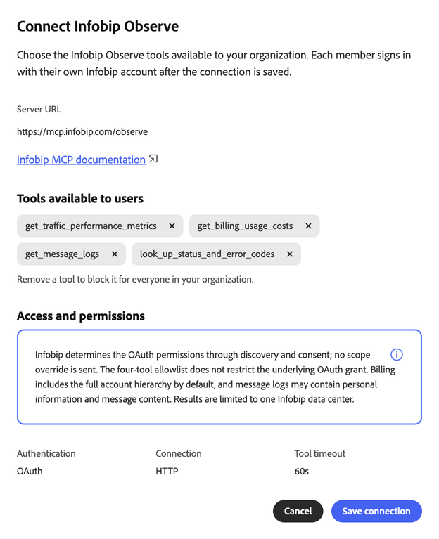

# Infobip Observe外部连接器 {#infobip-observe}

使用[!DNL Infobip Observe]外部连接器查看Adobe CX Enterprise Coworker中的[!DNL Infobip]流量和成本。 设置连接器后，向同事咨询流量指标、计费使用情况、消息日志、状态和错误代码。 连接器是[!DNL Infobip]承载的[!DNL Observe]模型上下文协议(MCP)服务器。

>[!AVAILABILITY]
>
>[!DNL Infobip Observe]外部连接器为Beta版。 文档和功能可能会发生变化。

## 连接器配置 {#connector-configuration}

连接器配置过程分为两个部分：

* **组织设置：**&#x200B;管理员为整个组织配置连接器一次，并批准成员可以使用的工具。
* **成员登录：**&#x200B;每个成员使用自己的[!DNL Infobip]帐户登录。 成员只能访问其[!DNL Infobip]帐户具有使用权限的数据。

连接器没有共享组织登录。 使用该连接器的每个成员都单独登录。 保存组织配置不会登录任何成员或授予其他[!DNL Infobip]权限。

## 先决条件 {#prerequisites}

连接器仅适用于[!DNL Infobip] [!DNL Observe] MCP服务器。 它未连接到[!DNL Infobip]消息传送、设置或帐户管理MCP服务器。

在开始之前，请确保您具备以下条件：

* **同事访问：**&#x200B;在有[!DNL Infobip Observe]连接器的组织中，具有管理组织连接器的权限的帐户。
* **[!DNL Infobip]帐户：**&#x200B;目标数据中心中具有[!DNL Observe]访问权限的已批准[!DNL Infobip]帐户。 [!DNL Infobip]提供[!DNL Observe] MCP作为早期访问功能。 通过[!DNL Infobip]确认您的权利和帐户适用性。
* **成员身份：**&#x200B;拥有自己的[!DNL Infobip]帐户和访问预期数据的权限的成员。
* **已批准的测试范围：**&#x200B;在查询帐单、流量或消息日志之前，已批准的测试范围和非敏感数据。

要测试连接器，您可以注册免费的[!DNL Infobip]试用帐户。 试用帐户不能保证数据隔离或零成本。 有关详细信息，请参阅[!DNL Infobip]文档中的[使用Infobip MCP服务器](https://www.infobip.com/docs/mcp/using-mcp){target="_blank"}和[观察MCP](https://www.infobip.com/docs/mcp/observe-mcp){target="_blank"}。

>[!IMPORTANT]
>
>切勿在屏幕截图、聊天或支持票证中共享密码、API密钥、令牌、授权代码或同意和回调URL。

## 连接和登录模型 {#connection-model}

Co-worker自动应用以下设置。 您既不创建OAuth应用程序，也不输入应用程序凭据。

| 设置 | 值 |
| --- | --- |
| 服务器URL | `https://mcp.infobip.com/observe` |
| 传输 | 可流式处理HTTP |
| 授权服务器发现 | `https://mcp.infobip.com/observe/.well-known/oauth-authorization-server` |
| 登录 | 每个成员均使用动态客户端注册使用OAuth登录 |
| OAuth配置 | 自动发现。 管理员不输入客户端ID、客户端密钥、范围或OAuth端点。 |
| 工具选择 | 四个批准的工具。 管理员可以缩小选择范围。 |

[!DNL Infobip]发现和每个成员的同意将决定同事收到的访问权限。 [!DNL Infobip]记录[!DNL Observe] MCP的`billing:usage:view`、`metrics:manage`、`messages-api:manage`和`error-codes:read`范围。 在批准之前，请在同意屏幕上查看请求的访问。

[!DNL Infobip]还在其他MCP客户端中支持[!DNL Observe] MCP的API密钥身份验证。 Co-worker不对此连接器使用API密钥。 成员仅使用OAuth登录。

## 为您的组织配置连接器 {#configure-organization}

管理员使[!DNL Infobip Observe]连接器对组织中的每个人可用。 组织页面上的更改适用于组织中的所有用户。 成员无法配置组织连接。

1. 打开&#x200B;**[!UICONTROL 自定义项]**，选择&#x200B;**[!UICONTROL 组织]**，然后选择&#x200B;**[!UICONTROL 外部连接器]**。

1. 查找&#x200B;**[!UICONTROL Infobip Observe]**，然后选择&#x200B;**[!UICONTROL 配置]**。

1. 在&#x200B;**[!UICONTROL 连接Infobip Observe]**&#x200B;对话框中，查看固定的&#x200B;**[!UICONTROL 服务器URL]**，`https://mcp.infobip.com/observe`。

   您无需输入OAuth客户端ID、客户端密钥或范围。

1. 在&#x200B;**[!UICONTROL 用户可用的工具]**&#x200B;下，查看最初选择的四个工具。 删除组织成员不应使用的任何工具。 必须至少保留一个工具。

   有关详细信息，请参阅[可用工具](#available-tools)。

   {width="500" zoomable="yes"}

1. Select **[!UICONTROL 保存连接]**。 然后重新打开配置，以验证是否仍然选择了工具。

保存操作不会将您或任何成员登录到[!DNL Infobip]。 若要自行检查连接，请按照[中的说明登录，并以成员身份登录](#sign-in-as-a-member)。

若要在删除任意工具后使所有四个工具再次可用，请选择&#x200B;**[!UICONTROL 还原所有工具]**。 此选项仅恢复四个批准的工具。 同事未启用[!DNL Infobip]稍后添加的工具。 如果未选择工具，则无法保存配置。

### 可用工具 {#available-tools}

[!DNL Infobip Observe]连接器提供了以下工具。 [!DNL Infobip]可以更改每个工具的限制，因此在依赖它们之前请查看[!DNL Infobip]文档。

| 工具 | 用途 | 限制 |
| --- | --- | --- |
| `get_traffic_performance_metrics` | 汇总的流量、交付和参与量度。 | 最多366天的数据。 每小时窗口最多可覆盖14天，每日窗口最多可覆盖93天。 默认情况下返回登录帐户的数据。 显式包含子帐户。 |
| `get_billing_usage_costs` | 与发票一致的使用和成本。 | 当前日历月和前两个日历月。 默认情况下包括完整的帐户层次结构。 一个月的数据是暂时的，直到下个月的第五天为止。 |
| `get_message_logs` | 单个消息的日志。 | 过去48小时 日志可以包括收件人标识符、个人信息和消息内容。 |
| `look_up_status_and_error_codes` | 已知状态和错误代码名称的描述。 | 每个请求最多50个名称。 [!DNL Infobip]可以从结果中忽略未知名称。 |

结果限制为一个[!DNL Infobip]数据中心。 工具选择可控制哪些工具成员可在Co-worker中使用。 它不会限制成员在登录时授予的[!DNL Infobip]访问权限、帐户层次结构或[!DNL Infobip]强制执行的权限。

>[!IMPORTANT]
>
>消息日志可以包含个人数据，如收件人标识符和消息内容。 帐单信息是敏感的，默认情况下涵盖整个帐户层次结构。 仅在您的组织批准使用这些工具时启用这些工具。 使用明确、批准的帐户过滤器和有限查询。

## 以成员身份登录 {#sign-in-as-a-member}

管理员配置连接器后，每个成员均使用自己的[!DNL Infobip]帐户登录。 您的登录仅属于您。 其他成员不使用您的凭据。

1. 打开&#x200B;**[!UICONTROL 自定义项]**，选择&#x200B;**[!UICONTROL 用户]**，然后选择&#x200B;**[!UICONTROL 外部连接器]**。 查找&#x200B;**[!UICONTROL Infobip观察者]**。

   如果卡片显示&#x200B;**[!UICONTROL 未配置]**&#x200B;和&#x200B;**[!UICONTROL 尚不可用。 您的管理员需要设置此项。]**，请要求您的管理员[配置连接器](#configure-organization)。

1. Select **[!UICONTROL 登录]**&#x200B;并使用预期的[!DNL Infobip]帐户。 完成单点登录(SSO)、多重身份验证(MFA)，并征得您同意。 在批准之前，请查看请求的访问权限、帐户和数据中心。

1. 返回同事并打开连接器详细信息。 查看管理员启用的工具。

   成员可以查看工具，但不能更改组织配置。

1. 选择&#x200B;**[!UICONTROL 测试连接]**。

   测试成功后，确认Co-worker可以连接并列出工具。 它不会确认每个工具是否都成功运行。

1. 如果您已获得授权并且管理员启用了`look_up_status_and_error_codes`工具，请在[中运行查找检查您的连接](#check-connection)。

1. 若要从连接器断开您的[!DNL Infobip]帐户，请选择&#x200B;**[!UICONTROL 注销]**。

   注销不一定撤销您在[!DNL Infobip]中授予的访问权限。

## 检查您的连接 {#check-connection}

要确认连接器是否可与您的帐户配合使用，请运行只读查找。 确保您的管理员启用了`look_up_status_and_error_codes`工具。 然后，开始聊天并输入提示。

示例提示：

* “使用Infobip Observe，查找状态代码NO_ERROR并描述其含义。 请勿查询流量指标、账单或消息日志。”

确认结果包含`NO_ERROR`的描述且没有错误消息。 成功的查找不会确认流量、账单或消息日志工具适用于您的帐户。 请勿仅为了测试连接而查询帐单或消息日志。

## 访问疑难解答 {#troubleshoot-access}

如果您无法访问您的[!DNL Infobip]数据，请与管理员核对以下事项：

| 问题 | 检查内容 |
| --- | --- |
| 缺少&#x200B;**[!UICONTROL Infobip Observe]**&#x200B;连接器 | 确认连接器对您的组织可用，并且您具有管理组织连接器的权限。 如有需要，请联系您的Adobe代表。 |
| 同意或登录失败 | 检查您使用的[!DNL Infobip]帐户、[!DNL Observe]权利文件和数据中心。 在请求帮助时，请勿共享同意URL、回调URL或授权码。 |
| 登录成功，但工具失败 | 检查有效的[!DNL Infobip]权限、您登录的帐户和数据中心以及[!DNL Infobip]返回的错误。 成功登录不会确认工具是否成功运行。 |
| 工具不可用 | 检查管理员启用的工具。 同事未自动启用新[!DNL Infobip]工具。 |
| 无法保存配置 | 至少保持选中一个工具。 要停止提供连接器，请将其移除。 |
| 计费结果包括意外帐户 | 默认情况下，开票结果包括完整的帐户层次结构。 停止，然后查看批准的帐户过滤器和权限。 |
| 消息日志显示敏感数据 | 停止查询，并将以后查询限制为已批准的非敏感数据。 请勿将原始日志粘贴到聊天或支持票证中。 |
| 状态代码查找成功，但另一个请求失败 | 分别调查失败的请求。 成功的查找不会确认每个工具或帐户都有效。 |
