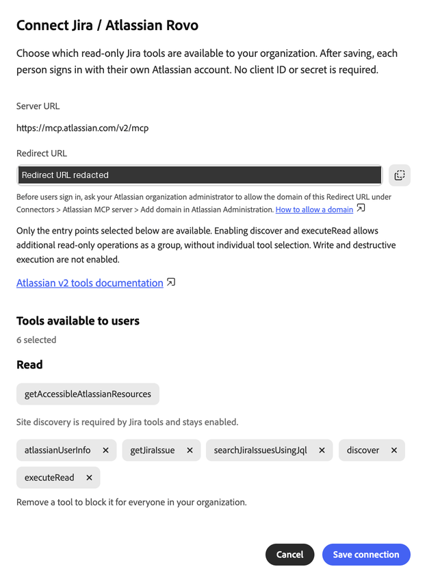

# Jira/Atlassian Rovo外部连接器 {#jira-atlassian-rovo}

使用[!DNL Jira] / [!DNL Atlassian Rovo]外部连接器读取和搜索Adobe CX Enterprise Coworker中的[!DNL Jira]工作项。 设置连接器后，请要求同事查找工作项、阅读其详细信息并使用Jira查询语言(JQL)进行搜索。 连接器是由[!DNL Atlassian]托管的模型上下文协议(MCP)服务器。

>[!AVAILABILITY]
>
>[!DNL Jira] / [!DNL Atlassian Rovo]外部连接器为Beta版。 文档和功能可能会发生变化。

## 连接器配置 {#connector-configuration}

连接器配置过程分为三个部分：

* **[!DNL Atlassian]准备：** [!DNL Atlassian]组织管理员允许同事重定向URL域并查看MCP访问策略。
* **组织设置：**&#x200B;同事管理员为整个组织配置连接器一次。 管理员选择成员可以使用的只读工具。
* **成员登录：**&#x200B;每个成员使用自己的[!DNL Atlassian]帐户登录。 成员只能访问其帐户有权查看的[!DNL Jira]数据。

保存组织配置不会登录任何成员或授予[!DNL Jira]权限。 每个成员必须单独登录。

连接器没有共享服务帐户或API令牌选项。 Co-worker自动向[!DNL Atlassian]注册OAuth应用程序，因此您不会输入客户端ID或客户端密码。

尽管连接器名称包含[!DNL Atlassian Rovo]，但连接器仅请求[!DNL Jira]读取和搜索访问权限。 它不请求[!DNL Confluence]、特定于[!DNL Rovo]的写入或破坏访问。 其他[!DNL Atlassian] MCP功能不一定可以通过此连接器使用。

## 先决条件 {#prerequisites}

在开始之前，请确保您具备以下条件：

* **对于组织设置：**&#x200B;在有[!DNL Jira] / [!DNL Atlassian Rovo]连接器的组织中，具有在同事中管理组织连接器的权限的帐户。
* **对于[!DNL Atlassian]准备：**&#x200B;可以批准MCP访问和同事重定向URL域的[!DNL Atlassian]组织管理员。
* **对于成员登录：** [!DNL Atlassian]帐户具有目标[!DNL Jira]站点、项目和工作项的访问权限。
* **对于网络访问：** [!DNL Atlassian]允许连接的IP和应用策略。 成功登录不会确认是否允许工具请求。
* **[!DNL Rovo]已启用：** [!DNL Rovo]已为您的[!DNL Atlassian]组织和目标[!DNL Jira]站点启用，然后成员才使用连接器。 有关详细信息，请参阅[!DNL Atlassian]文档中的[如何启用Rovo](https://www.atlassian.com/software/rovo/guides/admin-guide/rovo-activation)。

## 准备[!DNL Atlassian]访问权限 {#prepare-atlassian}

在成员登录之前，[!DNL Atlassian]组织管理员在[!DNL Atlassian Administration]中准备访问权限：

1. 打开[!DNL Atlassian Administration]，然后选择目标组织。

1. Select **[!UICONTROL 连接器]** > **[!UICONTROL Atlassian MCP服务器]** > **[!UICONTROL 添加域]**。

1. 添加在辅助进程设置对话框中显示的&#x200B;**[!UICONTROL 重定向URL]**&#x200B;的域。 有关对话框，请参阅[为组织配置连接器](#configure-organization)。

   遵循[!DNL Atlassian]域格式规则而不是粘贴完整URL。 有关详细信息，请参阅[!DNL Atlassian]文档中的[可用的Atlassian MCP服务器域](https://support.atlassian.com/security-and-access-policies/docs/available-atlassian-mcp-server-domains/)。

1. 与[!DNL Atlassian]管理员一起检查MCP权限组、应用程序策略和IP允许列表。 有关详细信息，请参阅以下[!DNL Atlassian]文档：

   * [受支持的Atlassian MCP工具](https://support.atlassian.com/atlassian-ai-gateway/docs/supported-tools/)，用于每个工具所需的权限组和范围
   * [控制Atlassian MCP服务器设置](https://support.atlassian.com/security-and-access-policies/docs/control-atlassian-mcp-server-settings/)，用于身份验证和IP身份验证

对于您设置的环境，始终使用“Co-worker”对话框中显示的重定向URL。 请勿从其他环境复制重定向URL。

## 为您的组织配置连接器 {#configure-organization}

管理员使[!DNL Jira] / [!DNL Atlassian Rovo]连接器可供组织中的每个人使用。 组织页面上的更改适用于组织中的所有用户。

1. 打开&#x200B;**[!UICONTROL 自定义项]**，选择&#x200B;**[!UICONTROL 组织]**，然后选择&#x200B;**[!UICONTROL 外部连接器]**。 在&#x200B;**[!UICONTROL Jira / Atlassian Rovo]**&#x200B;卡上，选择&#x200B;**[!UICONTROL 配置]**。 成员无法配置或删除此连接。

1. 在&#x200B;**[!UICONTROL 连接Jira / Atlassian Rovo]**&#x200B;对话框中，查看固定的&#x200B;**[!UICONTROL 服务器URL]**，`https://mcp.atlassian.com/v2/mcp`。

   查看&#x200B;**[!UICONTROL 重定向URL]**，并确保[!DNL Atlassian]管理员批准其域，如[准备Atlassian访问](#prepare-atlassian)中所述。 您未输入任何OAuth凭据。

1. 在&#x200B;**[!UICONTROL 用户可用的工具]**&#x200B;下，选择成员可以使用的工具。 有关详细信息，请参阅[可用工具](#available-tools)。

   `getAccessibleAtlassianResources`站点发现工具是必需的，并且保持启用状态。 其他五个工具是可选的。 要阻止组织中每个人的可选工具，请删除它。 若要恢复您删除的工具，请选择&#x200B;**[!UICONTROL 还原所有工具]**。 在仅启用站点发现的情况下可以保存配置，但成员无法读取或搜索工作项。

   {width="500" zoomable="yes"}

1. Select **[!UICONTROL 保存连接]**，然后查看连接详细信息。

   当每个成员登录时，连接器会请求以下OAuth范围：

   | 范围 | 用途 |
   | --- | --- |
   | `read:me`, `read:account` | 支持对该成员的[!DNL Atlassian]帐户进行授权。 |
   | `read:jira:agent-interface` | 读取[!DNL Jira]数据。 |
   | `search:jira:agent-interface` | 搜索[!DNL Jira]数据。 |
   | `offline_access` | 刷新登录令牌。 |

   工具超时为60秒。 第一次连接和工具发现可能需要更长的时间。

### 可用工具 {#available-tools}

[!DNL Jira] / [!DNL Atlassian Rovo]连接器提供了以下只读工具：

| 工具 | 描述 | 管理员控制 |
| --- | --- | --- |
| `getAccessibleAtlassianResources` | 查找您可以访问的[!DNL Atlassian]网站和云ID。 [!DNL Jira]工具需要此工具。 | 必需 |
| `atlassianUserInfo` | 获取登录用户的帐户信息。 | 可选 |
| `getJiraIssue` | 按ID或键获取[!DNL Jira]工作项。 | 可选 |
| `searchJiraIssuesUsingJql` | 使用JQL搜索[!DNL Jira]工作项。 | 可选 |
| `discover` | 查找其他工具操作及其输入架构。 | 可选 |
| `executeRead` | 运行通过`discover`找到的读取操作，如读取注释、更改日志、项目、展示板和冲刺。 | 可选 |

>[!IMPORTANT]
>
>`discover`和`executeRead`工具授予成员以组身份访问其他允许的读取操作的权限。 您无法关闭单个操作。 如果贵组织不接受此访问，请删除这两个工具。 连接器不包括写入操作(`executeWrite`)或破坏性操作(`executeDestructive`)。

删除可选工具限制了其在Co-worker中的可用性。 它不会减少连接器在登录时请求的OAuth范围。

每个工具都需要特定的[!DNL Atlassian]权限组和范围。 有关详细信息，请参阅[!DNL Atlassian]文档中的[支持的Atlassian MCP工具](https://support.atlassian.com/atlassian-ai-gateway/docs/supported-tools/)。

## 以成员身份登录 {#sign-in-as-a-member}

管理员配置连接器后，每个成员均使用自己的[!DNL Atlassian]帐户登录。 您不需要客户端ID、客户端密钥或访问令牌即可登录。

1. 打开&#x200B;**[!UICONTROL 自定义项]**，选择&#x200B;**[!UICONTROL 用户]**，然后选择&#x200B;**[!UICONTROL 外部连接器]**。

1. 查找&#x200B;**[!UICONTROL Jira / Atlassian Rovo]**&#x200B;卡。 如果卡片显示&#x200B;**[!UICONTROL 未配置]**&#x200B;和&#x200B;**[!UICONTROL 尚不可用。 您的管理员需要设置此项。]**，请要求您的管理员[配置连接器](#configure-organization)。 成员无法配置连接器。

1. Select **[!UICONTROL 登录]**，并使用有权访问目标[!DNL Jira]网站的[!DNL Atlassian]帐户。 完成任何所需的单点登录(SSO)、多重身份验证(MFA)和同意提示。 在您同意之前，请查看请求的读取和搜索访问权限。

   >[!IMPORTANT]
   >
   >只有在您识别应用程序并且组织批准请求的访问权限时，才应继续。

1. 返回到Co-worker，并打开连接器详细信息。 对于成员，该连接是只读的，您可以查看管理员启用的工具。 Select **[!UICONTROL 测试连接]**&#x200B;以确认连接。

1. 或者，运行小型只读检查，如[检查Jira访问权限](#check-access)中所述。

成功的测试不会确认您是否可以访问每个[!DNL Jira]站点、项目或工作项。

## 检查您的[!DNL Jira]访问权限 {#check-access}

要确认连接器可以读取您的数据，请开始聊天并输入只读提示。

示例提示：

* “在Jira中搜索分配给我的最多五个工作项，按最近更新的顺序排列。 包含其键和链接。 不要修改任何内容。”

要使此提示生效，您的管理员必须启用搜索工具，并且您的[!DNL Jira]帐户必须具有查看工作项的权限。

## 访问疑难解答 {#troubleshoot-access}

如果登录或访问失败，请与管理员核对以下事项：

| 问题 | 检查内容 |
| --- | --- |
| 客户端或域的登录被阻止 | 在&#x200B;**[!UICONTROL Atlassian MCP服务器]**&#x200B;设置下，确认已在[!DNL Atlassian Administration]中批准您环境的重定向URL域。 |
| 同意成功，但工具调用被拒绝 | 检查您的[!DNL Jira]权限、[!DNL Atlassian] MCP权限组、应用程序策略和IP。 有关每个工具所需的权限组，请参阅[支持的Atlassian MCP工具](https://support.atlassian.com/atlassian-ai-gateway/docs/supported-tools/)。 |
| JQL搜索失败，但其他读取起作用 | 确认您的管理员启用了`searchJiraIssuesUsingJql`，并且连接请求了`search:jira:agent-interface`作用域。 |
| 同意返回`invalid_request` | 要求您的管理员确认连接请求`read:me`和`read:account`以及[!DNL Jira]范围。 |
| 更改后，您仍可以看到较旧的范围 | 过时的用户级`jira_login`身份验证提供程序覆盖优先于组织连接。 要求管理员仅更新或移除该过时的覆盖，然后重新登录。 |
| 缺少工具 | 要求管理员检查工具选择。 其他读取操作需要`discover`和`executeRead`、所需的范围以及正确的权限。 |
| **[!UICONTROL 测试连接]**&#x200B;缓慢或超时 | 工具发现可能需要超过60秒的工具超时时间。 在更改凭据之前，检查问题是发现速度缓慢还是登录失败。 |

当您请求帮助时，请勿共享密码、令牌、授权码或同意URL。 请勿将其包含在屏幕截图或支持票证中。
