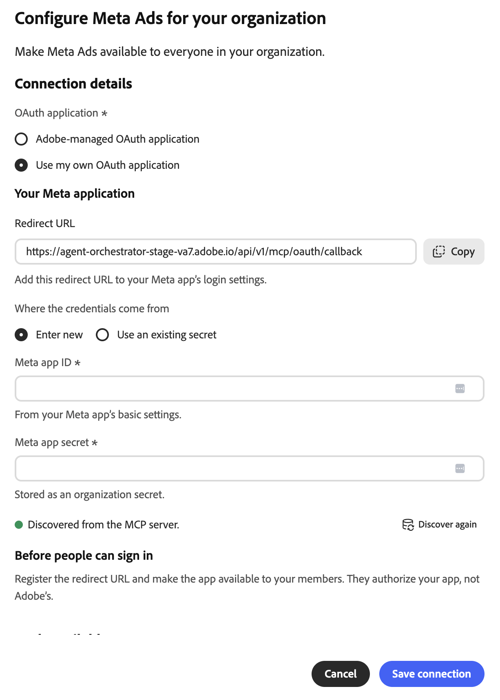

# Meta Ads外部连接器 {#meta-ads}

使用[!DNL Meta Ads]外部连接器在Adobe CX Enterprise Coworker中使用[!DNL Meta]广告数据。 设置连接器后，请让同事报告广告效果、管理活动和受众、使用产品目录等。 连接器是由[!DNL Meta]托管的模型上下文协议(MCP)服务器。

>[!AVAILABILITY]
>
>[!DNL Meta Ads]外部连接器为Beta版。 文档和功能可能会发生变化。

## 连接器配置 {#connector-configuration}

连接器配置过程分为两个部分：

* **组织设置：**&#x200B;管理员为整个组织配置连接器一次。 管理员选择OAuth应用程序并选择成员可以使用的工具。
* **成员登录：**&#x200B;每个成员使用自己的[!DNL Facebook]帐户登录。 成员只能访问其[!DNL Facebook]标识和授权应用允许的[!DNL Meta]资源。

保存组织配置不会登录任何成员或授予对广告帐户的访问权限。 每个成员必须单独登录。

## 先决条件 {#prerequisites}

在开始之前，请确保您具备以下条件：

* **对于组织设置：**&#x200B;具有在同事中管理组织连接器的权限的帐户。
* **对于成员登录：**&#x200B;具有广告帐户、企业、页面或您计划使用的其他[!DNL Meta]资产访问权限的[!DNL Facebook]帐户。
* **对于您自己的OAuth应用程序（可选）：**&#x200B;您的组织管理的[!DNL Meta]应用程序，以及其应用程序ID和应用程序密钥。

## 为您的组织配置连接器 {#configure-organization}

管理员使[!DNL Meta Ads]连接器对组织中的每个人可用。 组织页面上的更改适用于组织中的所有用户。

1. 打开&#x200B;**[!UICONTROL 自定义项]**，选择&#x200B;**[!UICONTROL 组织]**，然后选择&#x200B;**[!UICONTROL 外部连接器]**。 在&#x200B;**[!UICONTROL Meta广告]**&#x200B;卡上，选择&#x200B;**[!UICONTROL 配置]**。

1. 在&#x200B;**[!UICONTROL 为您的组织配置Meta广告]**&#x200B;对话框中，查看&#x200B;**[!UICONTROL 连接详细信息]**，然后选择&#x200B;**[!UICONTROL OAuth应用程序]**：

   * **[!UICONTROL Adobe管理的OAuth应用程序]：** Adobe提供了[!DNL Meta Ads]应用程序，因此您无需输入应用程序凭据。 保存后，每个成员仍然使用自己的[!DNL Facebook]帐户登录。

     {width="500" zoomable="yes"}

   * **[!UICONTROL 使用我自己的OAuth应用程序]：**&#x200B;您的组织提供自己的[!DNL Meta]应用程序。 成员授权您的应用程序，而非Adobe应用程序。 在&#x200B;**[!UICONTROL 您的Meta应用程序]**&#x200B;下，完成以下步骤：

     1. 复制&#x200B;**[!UICONTROL 重定向URL]**，并将其添加到[!DNL Meta]应用的登录设置中。 由于不同环境之间的重定向URL不同，因此请使用对话框中显示的确切值。
     1. 在&#x200B;**[!UICONTROL 凭据来自]**&#x200B;下，选择&#x200B;**[!UICONTROL 输入新的]**，然后输入&#x200B;**[!UICONTROL Meta应用程序ID]**&#x200B;和&#x200B;**[!UICONTROL Meta应用程序密钥]**。 在[!DNL Meta]应用程序的基本设置中查找应用程序ID。 同事会将应用程序密钥存储为组织密钥。 若要改用同一应用已保存的凭据，请选择&#x200B;**[!UICONTROL 使用现有密码]**。
     1. 使应用程序对将要登录的成员可用。 请咨询您的[!DNL Meta]应用程序管理员，确认所需的权限以及您预期用途的任何应用程序审阅要求。

     从MCP服务器&#x200B;**发现的**&#x200B;指示符确认同事找到了连接器。 它不会确认您的应用程序凭据是否有效或成员是否已登录。 要刷新发现，请再次选择&#x200B;**[!UICONTROL 发现]**。

     {width="500" zoomable="yes"}

1. 在&#x200B;**[!UICONTROL 用户可用的工具]**&#x200B;下，展开每个工具组并选择组织所需的工具。 若要一次更改所有工具，请使用&#x200B;**[!UICONTROL 全选]**&#x200B;或&#x200B;**[!UICONTROL 全部清除]**。 有关详细信息，请参阅[工具组](#tool-groups)。 然后选择&#x200B;**[!UICONTROL 保存连接]**。

   {width="500" zoomable="yes"}

1. 查看保存的&#x200B;**[!UICONTROL meta-ads]**&#x200B;连接器详细信息。 （可选）选择&#x200B;**[!UICONTROL 测试]**&#x200B;以检查同事是否可以发现连接器工具。

   | 设置 | 说明 |
   | --- | --- |
   | **[!UICONTROL Source]** | [!DNL Meta Ads] MCP服务器`https://mcp.facebook.com/ads`。 |
   | **[!UICONTROL 身份验证]** | 身份验证方法`meta-ads_login`。 |
   | **[!UICONTROL Connection]** | 正在使用的OAuth应用程序以及您自己的登录状态。 |
   | **[!UICONTROL 工具]** | 为成员选择的工具，具有&#x200B;**[!UICONTROL 全选]**&#x200B;和&#x200B;**[!UICONTROL 清除]**&#x200B;控件以及所选工具的计数。 |

   {width="700" zoomable="yes"}

连接器详细信息中的&#x200B;**[!UICONTROL 未登录]**&#x200B;状态是指您自己的连接，而不是与组织的连接。 若要自行使用连接器，请选择&#x200B;**[!UICONTROL 登录]**&#x200B;并按照[以成员身份登录](#sign-in-as-a-member)中的步骤操作。

要停止向您的组织提供连接器，请在连接器详细信息页面上选择&#x200B;**[!UICONTROL 删除]**。

### 工具组 {#tool-groups}

[!DNL Meta Ads]连接器将其工具组织为以下组：

* [!UICONTROL 报告和分析]
* [!UICONTROL 广告、营销活动和受众]
* [!UICONTROL 目录和产品]
* [!UICONTROL 信号和数据集]
* [!UICONTROL A/B测试和提升研究]
* [!UICONTROL 活动日志]
* [!UICONTROL 帮助和疑难解答]

例如，[!UICONTROL 报告和分析]组包含`ads_insights_performance_trend`和`ads_insights_industry_benchmark`等工具。 随着[!DNL Meta]更新连接器，每个组中的工具都可以更改。

>[!IMPORTANT]
>
>并非每个工具都是只读的。 某些工具可以更改营销活动、预算、受众、目录或其他广告资产。 仅选择您的组织希望成员使用的工具。

保存后，成员将无法使用未选定的工具，直到您选择它们为止。 要确认成员可以使用哪些工具，请查看连接器详细信息页面上的&#x200B;**[!UICONTROL 可用工具]**&#x200B;部分。

## 以成员身份登录 {#sign-in-as-a-member}

管理员配置连接器后，每个成员均使用自己的[!DNL Facebook]帐户登录。 您不需要应用程序密钥或访问令牌即可登录。

1. 打开&#x200B;**[!UICONTROL 自定义项]**，选择&#x200B;**[!UICONTROL 用户]**，然后选择&#x200B;**[!UICONTROL 外部连接器]**。

1. 在&#x200B;**[!UICONTROL Meta广告]**&#x200B;卡上，选择&#x200B;**[!UICONTROL 登录]**。

   如果卡显示&#x200B;**[!UICONTROL 未配置]**&#x200B;或连接器不可用，请要求管理员[配置连接器](#configure-organization)。

1. 登录到[!DNL Facebook]并完成任何必需的提示，如单点登录(SSO)、多重身份验证(MFA)、同意或身份验证。

   这些提示的顺序取决于您的帐户和组织策略。 首次用户可能还会看到授予权限和选择资源的提示。

1. 查看[!DNL Facebook]帐户和您授权的应用程序，然后执行以下操作之一：

   * 若要保留以前的设置，请选择&#x200B;**[!UICONTROL 继续]**。
   * 若要查看或更改授权，请选择&#x200B;**[!UICONTROL 编辑设置]**。
   * 若要使用其他[!DNL Facebook]帐户，请选择&#x200B;**[!UICONTROL 登录到其他帐户]**。

   使用Adobe管理的应用程序，您授权[!DNL Adobe Experience Cloud]。 对于您自己的组织应用程序，应用程序名称和提示会有所不同。

   {width="400" zoomable="yes"}

   >[!IMPORTANT]
   >
   >应用程序接收对您共享信息的持续访问，并在应用程序访问这些信息时记录[!DNL Meta]。 仅当您的组织批准请求的访问权限时，才继续。

1. 在[!DNL Facebook]将您返回到Co-worker后，打开&#x200B;**[!UICONTROL meta-ads]**&#x200B;连接器详细信息。 确认连接器显示&#x200B;**[!UICONTROL 已连接]**&#x200B;和&#x200B;**[!UICONTROL 已登录]**。

   {width="700" zoomable="yes"}

1. 查看管理员启用的&#x200B;**[!UICONTROL 工具]**&#x200B;以查看可以使用的工具。

连接器详细信息还显示&#x200B;**[!UICONTROL 工具超时]**&#x200B;设置和以下控件：

* **[!UICONTROL 重新加载工具]：**&#x200B;刷新工具列表。
* **[!UICONTROL 测试]：**&#x200B;检查同事是否可以发现连接器工具。
* **[!UICONTROL 注销]：**&#x200B;从连接器断开您的[!DNL Facebook]帐户。

**[!UICONTROL 已连接]**&#x200B;状态不确认访问特定广告帐户或每个工具是否成功运行。 若要确认您的访问权限，请[检查您的广告帐户访问权限](#check-ad-account-access)。

## 检查您的广告帐户访问权限 {#check-ad-account-access}

要确认您可以使用哪些广告帐户，请开始聊天并输入只读提示。

示例提示：

* “我可以访问哪些Meta广告帐户？ 列出它们而不做任何更改。”

如果您的管理员启用了`ads_get_ad_accounts`工具，同事将列出您可以访问的广告帐户。 对于每个帐户，“同事”将显示所属业务、 MCP资格和报告可用性。 在请求报表或执行操作之前，请选择一个可访问的帐户。

## 访问疑难解答 {#troubleshoot-access}

如果您无法访问[!DNL Meta]资源，请检查以下各项：

| 面积 | 检查内容 |
| --- | --- |
| [!DNL Facebook]帐户 | 您使用有权访问广告帐户的[!DNL Facebook]帐户登录。 |
| 资源权限 | 您的[!DNL Facebook]帐户对您要使用的广告帐户、企业或页面具有权限。 |
| 应用程序授权 | 您已授权应用程序并共享所需的资产。 若要查看授权，请注销并重新登录，然后选择&#x200B;**[!UICONTROL 编辑设置]**。 |
| 启用的工具 | 您的管理员在&#x200B;**[!UICONTROL 用户可用的工具]**&#x200B;下启用了所需的工具。 |
| 您自己的OAuth应用程序 | 重定向URL完全匹配，应用程序ID和应用程序密钥正确，成员有权访问应用程序。 向您的[!DNL Meta]应用管理员确认所需的权限。 |
