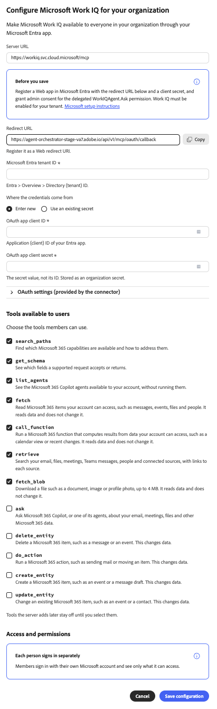

# Microsoft Work IQ外部连接器 {#microsoft-work-iq}

使用[!DNL Microsoft Work IQ]外部连接器在Adobe CX Enterprise Coworker中处理[!DNL Microsoft 365]数据。 设置连接器后，请让同事搜索您的电子邮件、文件、会议和[!DNL Microsoft Teams]消息，并查看日历活动等。 连接器是由[!DNL Microsoft]托管的模型上下文协议(MCP)服务器。

>[!AVAILABILITY]
>
>[!DNL Microsoft Work IQ]外部连接器为Beta版。 文档和功能可能会发生变化。

## 连接器配置 {#connector-configuration}

连接器配置过程分为两个部分：

* **组织设置：**&#x200B;管理员为整个组织配置连接器一次。 管理员连接[!DNL Microsoft Entra]应用并选择成员可以使用的工具。
* **成员登录：**&#x200B;每个成员使用自己的[!DNL Microsoft]工作帐户登录。 成员只能访问其帐户可访问的数据。

保存组织配置不会登录任何成员或授予其他[!DNL Microsoft 365]权限。 每个成员必须单独登录。

**[!UICONTROL Microsoft Work IQ]**&#x200B;卡提及共享的OAuth应用程序，该应用程序仅在您的部署配置了一个时才可用。 请不要假定已提供了应用程序。 本页介绍如何连接您自己的[!DNL Microsoft Entra]应用程序。

## 先决条件 {#prerequisites}

在开始之前，请确保您具备以下条件：

* **对于组织设置：**&#x200B;具有在同事中管理组织连接器的权限的帐户。
* **对于[!DNL Microsoft Entra]应用：**&#x200B;可以注册Web应用并授予管理员同意的[!DNL Microsoft Entra]管理员。
* **对于您的[!DNL Microsoft]租户：** [!DNL Work IQ]已为租户启用。
* **对于成员登录：**&#x200B;有资格的[!DNL Microsoft]工作帐户，可以访问您计划使用的数据。

## 为您的组织配置连接器 {#configure-organization}

管理员使[!DNL Microsoft Work IQ]连接器对组织中的每个人可用。 组织页面上的更改适用于组织中的所有用户。

1. 打开&#x200B;**[!UICONTROL 自定义项]**，选择&#x200B;**[!UICONTROL 组织]**，然后选择&#x200B;**[!UICONTROL 外部连接器]**。 在&#x200B;**[!UICONTROL Microsoft Work IQ]**&#x200B;卡上，选择&#x200B;**[!UICONTROL 配置]**。

1. 在&#x200B;**[!UICONTROL 为您的组织配置Microsoft工作IQ]**&#x200B;对话框中，查看&#x200B;**[!UICONTROL 服务器URL]**，`https://workiq.svc.cloud.microsoft/mcp`。 然后准备您的[!DNL Microsoft Entra]应用。 对于[!DNL Microsoft]要求，请在对话框中选择&#x200B;**[!UICONTROL Microsoft设置说明]**。

   1. 在[!DNL Microsoft Entra]中注册Web应用，或使用现有应用。
   1. 从对话框中复制&#x200B;**[!UICONTROL 重定向URL]**，并在应用程序上将此精确值注册为Web重定向URI。 不同环境之间的重定向URL不同，因此请始终从对话框中复制该URL。
   1. 创建客户端密钥，或确认现有客户端密钥仍然有效。 你需要的是机密值，而不是机密ID。
   1. 为委派的`WorkIQAgent.Ask`权限授予管理员同意，并确认已为您的租户启用[!DNL Work IQ]。

   在&#x200B;**[!UICONTROL Microsoft Entra租户ID]**&#x200B;中，输入您的租户ID。 在[!DNL Microsoft Entra]中，在&#x200B;**[!UICONTROL 概述]** > **[!UICONTROL 目录（租户） ID]**&#x200B;中找到此值。

   {width="500" zoomable="yes"}

1. 在&#x200B;**[!UICONTROL 凭据来自]**&#x200B;下，选择以下选项之一：

   * **[!UICONTROL 输入新的]：**&#x200B;在&#x200B;**[!UICONTROL OAuth应用程序客户端ID]**&#x200B;中，输入[!DNL Microsoft Entra]应用程序的应用程序（客户端）ID。 在&#x200B;**[!UICONTROL OAuth应用程序客户端密钥]**&#x200B;中，输入密钥值。 同事将密码值存储为组织密码。
   * **[!UICONTROL 使用现有密码]：**&#x200B;在包含客户端ID **的**&#x200B;[!UICONTROL &#x200B;密码和包含客户端密码&#x200B;]&#x200B;**的**&#x200B;密码中，为您的应用程序选择保存的组织密码。 如果没有正确的密钥，请选择&#x200B;**[!UICONTROL 输入新的]**。 您仍然需要单独输入租户ID。

   租户ID、客户端ID和客户端密钥必须全都属于同一应用程序和租户。 如果重用保存的密钥，请确认客户端密钥未过期。 这些应用凭据与成员用于登录的[!DNL Microsoft]密码不同。

   {width="500" zoomable="yes"}

1. 在&#x200B;**[!UICONTROL 用户可用的工具]**&#x200B;下，选择组织所需的工具。 有关详细信息，请参阅[可用工具](#available-tools)。 查看&#x200B;**[!UICONTROL 访问和权限]**，确认每个人单独登录，然后选择&#x200B;**[!UICONTROL 保存配置]**。

   {zoomable="yes"}

1. 查看保存的&#x200B;**[!UICONTROL workiq]**&#x200B;连接器详细信息。 （可选）选择&#x200B;**[!UICONTROL 测试]**&#x200B;以检查同事是否可以发现连接器工具。 要在保存后更改工具，请参阅[更改工具选择](#change-tool-selection)。

   | 设置 | 说明 |
   | --- | --- |
   | **[!UICONTROL Source]** | [!DNL Work IQ] MCP服务器`https://workiq.svc.cloud.microsoft/mcp`。 |
   | **[!UICONTROL 身份验证]** | 身份验证方法`workiq_login`。 |
   | **[!UICONTROL 工具超时]** | 连接器的工具超时。 |
   | **[!UICONTROL Connection]** | 您自己的登录状态。 |

   {width="500" zoomable="yes"}

连接器详细信息中的&#x200B;**[!UICONTROL 未登录]**&#x200B;状态是指您自己的连接，而不是与组织的连接。 若要自行使用连接器，请选择&#x200B;**[!UICONTROL 登录]**&#x200B;并按照[以成员身份登录](#sign-in-as-a-member)中的步骤操作。

要停止向您的组织提供连接器，请在连接器详细信息页面上选择&#x200B;**[!UICONTROL 删除]**。

### 可用工具 {#available-tools}

[!DNL Microsoft Work IQ]连接器提供了以下工具：

| 工具 | 描述 |
| --- | --- |
| `search_paths` | 查找哪些[!DNL Microsoft 365]功能可用以及如何解决这些功能。 |
| `get_schema` | 查看受支持的请求所接受或返回的字段。 |
| `list_agents` | 查看您的帐户可用的[!DNL Microsoft 365 Copilot]代理，而无需运行它们。 |
| `fetch` | 读取您的帐户可以访问的[!DNL Microsoft 365]项，如邮件、事件、文件和人员。 不更改数据。 |
| `call_function` | 根据帐户可访问的数据计算结果，例如日历视图或最近更改。 不更改数据。 |
| `retrieve` | 搜索包含每个源链接的电子邮件、文件、会议、[!DNL Microsoft Teams]消息、人员和已连接源。 |
| `fetch_blob` | 下载文件，如文档、图像或个人资料照片，最大为4 MB。 不更改数据。 |
| `ask` | 询问[!DNL Microsoft 365 Copilot]或其代理人的有关您的电子邮件、会议、文件和其他[!DNL Microsoft 365]数据的信息。 |
| `delete_entity` | 删除[!DNL Microsoft 365]项，如消息或事件。 更改数据。 |
| `do_action` | 运行[!DNL Microsoft 365]操作，如发送邮件或移动项目。 更改数据。 |
| `create_entity` | 创建[!DNL Microsoft 365]项目，如事件或消息草稿。 更改数据。 |
| `update_entity` | 更改现有[!DNL Microsoft 365]项目，如事件或联系人。 更改数据。 |

>[!IMPORTANT]
>
>`delete_entity`、`do_action`、`create_entity`和`update_entity`工具更改了[!DNL Microsoft 365]中的数据。 仔细查看这些工具，并仅选择组织希望成员使用的工具。

服务器以后添加的工具将保持关闭状态，直到您选择它们。

### 更改工具选择 {#change-tool-selection}

若要更改保存后成员可用的工具，请使用连接器详细信息页面上的&#x200B;**[!UICONTROL 工具]**&#x200B;部分。

1. 选择或清除单个工具，或使用&#x200B;**[!UICONTROL 选择所有]**&#x200B;或&#x200B;**[!UICONTROL 清除]**。

1. 选择&#x200B;**[!UICONTROL 保存工具选择]**。

>[!CAUTION]
>
>选择&#x200B;**[!UICONTROL 显示每个工具]**&#x200B;将清除当前选择。 然后，成员可以使用策略不排除的每个工具，直到您保存新的选择为止。 不要选择&#x200B;**[!UICONTROL 仅显示每个工具]**&#x200B;以查看工具列表。

## 以成员身份登录 {#sign-in-as-a-member}

管理员配置连接器后，每个成员均使用自己的[!DNL Microsoft]工作帐户登录。 您无需应用程序客户端密钥即可登录。

1. 打开&#x200B;**[!UICONTROL 自定义项]**，选择&#x200B;**[!UICONTROL 用户]**，然后选择&#x200B;**[!UICONTROL 外部连接器]**。

1. 在&#x200B;**[!UICONTROL Microsoft Work IQ]**&#x200B;卡上，选择&#x200B;**[!UICONTROL 登录]**。

   如果卡显示&#x200B;**[!UICONTROL 未配置]**&#x200B;或连接器不可用，请要求管理员[配置连接器](#configure-organization)。

1. 在[!DNL Microsoft] **[!UICONTROL 选择帐户]**&#x200B;屏幕上，为您的组织选择工作帐户，或选择&#x200B;**[!UICONTROL 使用其他帐户]**。

   您的浏览器可能会记住多个帐户，包括其他租户的帐户。 已登录的帐户并不总是正确的。 选择您需要[!DNL Microsoft 365]访问权限的帐户。

   {width="400" zoomable="yes"}

1. 完成您帐户的登录步骤，例如密码、单点登录(SSO)、无密码登录、多重身份验证(MFA)或其他验证。

   仅在您的组织批准的登录流程中输入您的[!DNL Microsoft]凭据。 切勿在连接器的OAuth应用程序字段中输入它们。

   {width="400" zoomable="yes"}

1. 如果[!DNL Microsoft]请求同意，请查看请求。

   >[!IMPORTANT]
   >
   >只有在您识别应用程序并且组织批准请求的访问权限时，才应继续。

1. 在[!DNL Microsoft]将您返回到同事之后，打开&#x200B;**[!UICONTROL workiq]**&#x200B;连接器详细信息。 确认连接器显示&#x200B;**[!UICONTROL 已连接]**&#x200B;和&#x200B;**[!UICONTROL 已登录]**。

   {width="700" zoomable="yes"}

1. 查看管理员启用的&#x200B;**[!UICONTROL 工具]**&#x200B;以查看可以使用的工具。

从连接器详细信息中，您还可以执行以下操作：

* **[!UICONTROL 测试]：**&#x200B;检查同事是否可以发现连接器工具。
* **[!UICONTROL 注销]：**&#x200B;从连接器断开您的[!DNL Microsoft]帐户。

连接器详细信息还显示&#x200B;**[!UICONTROL 工具超时]**&#x200B;设置和&#x200B;**[!UICONTROL 刷新]**&#x200B;控件。

**[!UICONTROL 已连接]**&#x200B;状态不能确认您可以访问每个[!DNL Microsoft 365]资源或每个工具都成功运行。 要确认您的访问权限，请[检查您的Microsoft 365访问权限](#check-access)。

## 检查您的Microsoft 365访问权限 {#check-access}

要确认连接器可以读取您的数据，请开始聊天并输入只读提示。

示例提示：

* “查找我明天的会议，并包含指向来源的链接。 不要创建、更新、发送或删除任何内容。”

要使此提示生效，您的管理员必须启用可读取日历数据的工具，并且您的帐户必须有权访问这些数据。

## 访问疑难解答 {#troubleshoot-access}

如果登录或访问失败，请与管理员核对以下事项：

| 面积 | 检查内容 |
| --- | --- |
| [!DNL Microsoft]帐户 | 您已使用目标租户的正确工作帐户登录。 |
| [!DNL Work IQ]可用性 | 已为您的[!DNL Microsoft]租户启用[!DNL Work IQ]。 |
| 重定向URI | [!DNL Microsoft Entra]应用程序具有注册为Web重定向URI的对话框中的确切重定向URL。 |
| 管理员同意 | 管理员已授予委派的`WorkIQAgent.Ask`权限管理员同意。 |
| 客户端密码 | 客户端密钥未过期，并且连接器使用密钥值，而不是密钥ID。 |
| 已保存的密钥 | 两个选定的组织密钥都属于预期的[!DNL Microsoft Entra]应用程序。 |
| 工具选择 | 如果只有一个工具失败，则管理员会启用该工具。 |
| [!DNL Microsoft 365]权限 | 您的帐户有权访问请求的数据。 |
