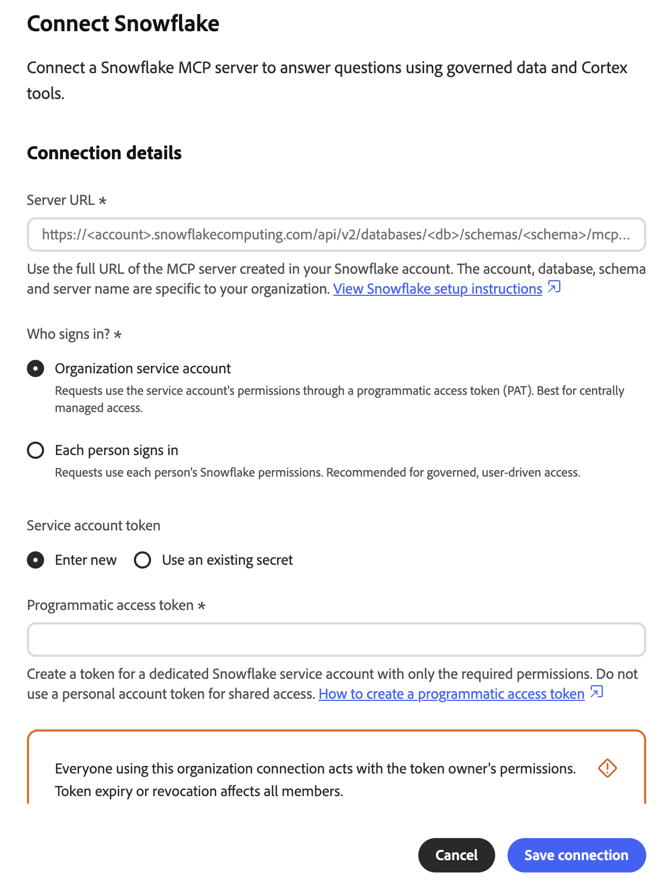
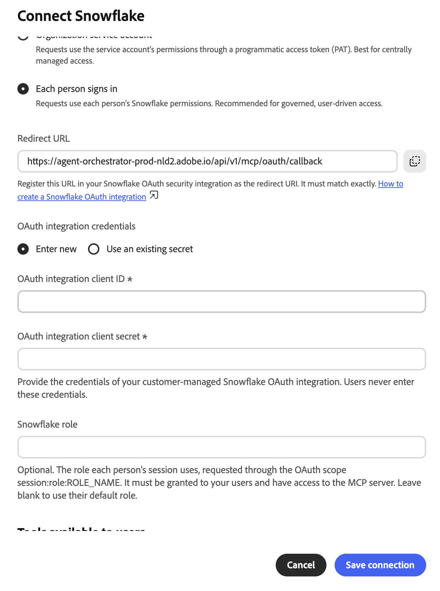
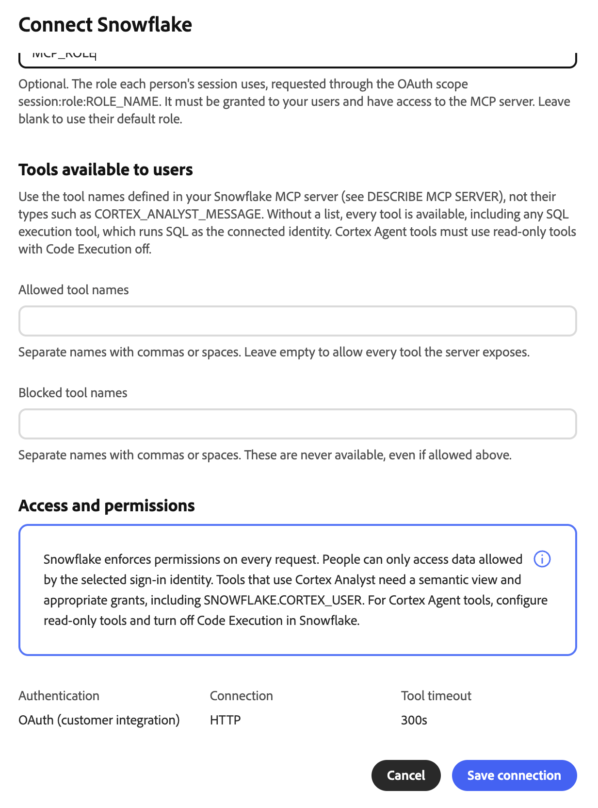
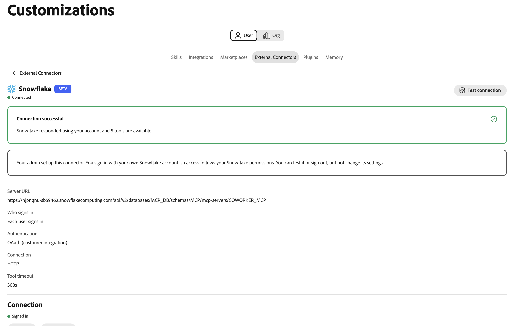

# Snowflake Cortex AI外部连接器 {#snowflake}

使用[!DNL Snowflake Cortex AI]外部连接器在Adobe CX Enterprise Coworker中以纯语言询问有关[!DNL Snowflake]数据的问题。 连接器将辅助进程链接到[!DNL Snowflake]帐户中的[!DNL Snowflake]托管模型上下文协议(MCP)服务器。 然后，同事可以使用服务器公开的工具，如[!DNL Cortex Analyst]、[!DNL Cortex Search]和SQL工具。

>[!AVAILABILITY]
>
>[!DNL Snowflake Cortex AI]外部连接器为Beta版。 文档和功能可能会发生变化。

## 连接器配置 {#connector-configuration}

连接器配置过程分为两个部分：

* **组织设置：**&#x200B;管理员将同事连接到现有的[!DNL Snowflake] MCP服务器，选择用户登录的方式，并选择成员可以使用的工具。
* **成员访问：**&#x200B;成员使用具有共享组织标识或他们自己的[!DNL Snowflake]标识的连接，具体取决于登录选项。

管理员选择以下登录选项之一：

| 选项 | 管理员提供的内容 | 访问的工作方式 |
| --- | --- | --- |
| **[!UICONTROL 组织服务帐户]** | 服务帐户的[!DNL Snowflake]编程访问令牌(PAT)。 | 所有成员都使用服务帐户的权限。 令牌过期或吊销会影响所有成员。 |
| **[!UICONTROL 每个人登录]** | [!DNL Snowflake] OAuth集成的客户端ID和客户端密钥，以及可选的[!DNL Snowflake]角色。 | 每个成员均使用自己的[!DNL Snowflake]身份登录，并按照其[!DNL Snowflake]权限进行访问。 |

这两个选项都不会授予所选身份尚不具有的[!DNL Snowflake]权限。 [!DNL Snowflake]对每个请求都实施权限。

## 先决条件 {#prerequisites}

同事连接到现有的[!DNL Snowflake] MCP服务器。 它不会创建服务器或其工具。 在开始之前，请确保您具备以下条件：

* **对于组织设置：**&#x200B;具有在同事中管理组织连接器的权限的帐户。
* **对于[!DNL Snowflake] MCP服务器：**&#x200B;服务器的完整HTTPS URL，包括其数据库、架构和服务器名称。
* **对于服务帐户选项：**&#x200B;专用服务帐户的PAT。 服务帐户角色应仅具有MCP服务器及其工具所需的权限。
* **对于个人登录选项：** [!DNL Snowflake] OAuth与其客户端ID和客户端密钥的集成。 您还需要一名[!DNL Snowflake]管理员，该管理员可以注册同事重定向URL并配置集成。

>[!IMPORTANT]
>
>切勿在屏幕截图、聊天或支持票证中共享PAT、OAuth客户端密钥或其他凭据。 使用组织密钥和权限最低的[!DNL Snowflake]标识。

### 配置Snowflake MCP服务器 {#configure-snowflake-mcp-server}

在配置连接器之前，[!DNL Snowflake]管理员必须在[!DNL Snowflake]中完成以下任务：

1. 创建MCP服务器并定义它公开的工具。
1. 授予所需的角色对MCP服务器、其工具和底层对象的访问权限。

   对MCP服务器的访问不会自动授予对每个工具或对象的访问权限。

1. 为计划使用的登录选项设置身份验证：

   * 对于服务帐户选项，请为服务帐户创建一个PAT。
   * 对于每人登录选项，创建可发出刷新令牌的OAuth集成。

有关说明，请参阅以下[!DNL Snowflake]文档：

* [Snowflake管理的MCP服务器](https://docs.snowflake.com/en/user-guide/snowflake-cortex/cortex-agents-mcp){target="_blank"}
* [创建MCP服务器](https://docs.snowflake.com/en/sql-reference/sql/create-mcp-server){target="_blank"}
* [访问控制概述](https://docs.snowflake.com/en/user-guide/security-access-control-overview){target="_blank"}
* [为自定义客户端配置Snowflake OAuth](https://docs.snowflake.com/en/user-guide/oauth-custom){target="_blank"}
* [创建安全集成(Snowflake OAuth)](https://docs.snowflake.com/en/sql-reference/sql/create-security-integration-oauth-snowflake){target="_blank"}
* [使用编程访问令牌进行身份验证](https://docs.snowflake.com/en/user-guide/programmatic-access-tokens){target="_blank"}

## 为您的组织配置连接器 {#configure-organization}

管理员使[!DNL Snowflake Cortex AI]连接器对组织中的每个人可用。 组织页面上的更改适用于组织中的所有用户。

1. 打开&#x200B;**[!UICONTROL 自定义项]**，选择&#x200B;**[!UICONTROL 组织]**，然后选择&#x200B;**[!UICONTROL 外部连接器]**。 在&#x200B;**[!UICONTROL Snowflake Cortex AI]**&#x200B;卡上，选择&#x200B;**[!UICONTROL 配置]**。

1. 在&#x200B;**[!UICONTROL 连接Snowflake Cortex AI]**&#x200B;对话框中，在&#x200B;**[!UICONTROL 服务器URL]**&#x200B;中输入[!DNL Snowflake] MCP服务器的完整URL。 URL必须使用HTTPS并遵循以下模式：

   ```text
   https://<account-host>/api/v2/databases/<database>/schemas/<schema>/mcp-servers/<server-name>
   ```

   使用您的[!DNL Snowflake]帐户和MCP服务器的确切URL。 帐户主机名不得包含下划线，包括编码下划线(`%5F`)。 不要在URL中包含凭据。 Co-worker在保存之前检查HTTPS方案、主机和路径。

1. 在&#x200B;**[!UICONTROL 登录者？]**&#x200B;下，选择一个登录选项，然后完成其设置。

   * **[!UICONTROL 组织服务帐户]：**&#x200B;请求通过编程访问令牌(PAT)使用该服务帐户的权限。 使用此选项可集中管理访问。 请使用作用域较窄的专用服务帐户，而不是个人帐户。

     {width="500" zoomable="yes"}

     | 设置 | 说明 |
     | --- | --- |
     | **[!UICONTROL 服务帐户令牌]** | 选择令牌的来源。 选择&#x200B;**[!UICONTROL 输入新的]**&#x200B;以输入PAT，或选择&#x200B;**[!UICONTROL 使用现有的密码]**&#x200B;以重用已包含令牌的组织密码。 现有密钥必须包含`Authorization`标头的完整值，而不仅仅是原始令牌。 |
     | **[!UICONTROL 编程访问令牌]** | 选择&#x200B;**[!UICONTROL 输入新的]**&#x200B;时必需。 为只有所需权限的专用[!DNL Snowflake]服务帐户创建令牌。 有关说明，请在对话框中选择&#x200B;**[!UICONTROL 如何创建编程访问令牌]**。 同事将令牌存储为组织密码。 |

     >[!IMPORTANT]
     >
     >使用此连接的每个人都需要令牌所有者的权限。 如果令牌过期或被撤销，则连接将停止对所有成员起作用。

     创建和使用PAT可能会受[!DNL Snowflake]网络和身份验证策略的约束。 如果令牌创建或身份验证被阻止，请让您的[!DNL Snowflake]管理员检查这些策略。

   * **[!UICONTROL 每个登录者]：**&#x200B;请求使用每个登录者的[!DNL Snowflake]权限。 使用此选项可进行受管理的用户驱动访问。

     {width="500" zoomable="yes"}

     | 设置 | 说明 |
     | --- | --- |
     | **[!UICONTROL 重定向URL]** | 只读。 复制此URL，并将其注册为您的[!DNL Snowflake] OAuth安全集成中的重定向URI。 该值必须完全匹配。 有关说明，请在对话框中选择&#x200B;**[!UICONTROL 如何创建Snowflake OAuth集成]**。 不同环境之间的重定向URL不同，因此请始终从对话框中复制该URL。 |
     | **[!UICONTROL OAuth集成凭据]** | 选择凭据的来源。 选择&#x200B;**[!UICONTROL 输入新的]**&#x200B;以输入客户端ID和客户端密钥，或选择&#x200B;**[!UICONTROL 使用现有密钥]**&#x200B;以选择包含它们的组织密钥。 |
     | **[!UICONTROL OAuth集成客户端ID]** | 选择&#x200B;**[!UICONTROL 输入新的]**&#x200B;时必需。 客户管理的[!DNL Snowflake] OAuth集成的客户端ID。 |
     | **[!UICONTROL OAuth集成客户端密钥]** | 选择&#x200B;**[!UICONTROL 输入新的]**&#x200B;时必需。 同一OAuth集成的客户端密码。 成员绝不输入这些凭据。 |
     | **[!UICONTROL Snowflake角色]** | 可选。 通过OAuth作用域`session:role:ROLE_NAME`请求的每个会话使用的角色。 该角色必须被授予您的成员，并且有权访问MCP服务器。 将该字段留空以使用每个成员的默认角色。 |

     同事从帐户URL派生OAuth端点并请求刷新令牌。 配置OAuth集成以发出刷新令牌。 仅请求的作用域不会覆盖集成配置。

     同事将角色名称转换为大写。 无法使用使用带引号的小写名称创建的角色。 如果OAuth集成阻止角色，或成员没有角色，则登录或访问可能会失败。

1. 在&#x200B;**[!UICONTROL 用户可用的工具]**&#x200B;下，选择成员可以使用的工具。 每个[!DNL Snowflake] MCP服务器定义自己的工具，因此该对话框不显示固定列表。 输入在MCP服务器中定义的工具名称，而不是工具类型，如`CORTEX_ANALYST_MESSAGE`。 要查看工具名称，请在[!DNL Snowflake]中运行`DESCRIBE MCP SERVER`。

   {width="500" zoomable="yes"}

   | 设置 | 说明 |
   | --- | --- |
   | **[!UICONTROL 允许的工具名称]** | 成员可以使用的工具。 用逗号或空格分隔名称。 将该字段留空可允许服务器公开的所有工具，但阻止的工具除外。 |
   | **[!UICONTROL 已阻止的工具名称]** | 成员永远不能使用的工具。 用逗号或空格分隔名称。 即使您还允许阻止的工具，这些工具也仍然不可用。 |

   >[!IMPORTANT]
   >
   >如果将&#x200B;**[!UICONTROL 允许的工具名称]**&#x200B;留空，则成员可以使用每个工具，包括任何SQL执行工具。 SQL执行工具将SQL作为连接的标识运行。 查看服务器上的工具定义，仅允许组织所需的工具。

   工具描述不能替代[!DNL Snowflake]权限或其他访问控制。 对于[!DNL Cortex Analyst]工具，请设置语义视图和所需的授权，包括`SNOWFLAKE.CORTEX_USER`数据库角色。 对于[!DNL Cortex Agent]工具，请配置只读工具并在[!DNL Snowflake]中关闭代码执行。 成员无法更改工具选择。

1. 查看&#x200B;**[!UICONTROL 访问和权限]**，然后选择&#x200B;**[!UICONTROL 保存连接]**。 **[!UICONTROL Snowflake Cortex AI]**&#x200B;卡显示已保存&#x200B;**[!UICONTROL 配置]**。

   选择&#x200B;**[!UICONTROL 查看配置]**&#x200B;以查看服务器URL、身份验证类型和工具策略。 然后选择&#x200B;**[!UICONTROL 测试连接]**&#x200B;以检查访问并发现服务器工具。

   新[!DNL Snowflake]连接使用300秒的工具超时。 没有保存超时的旧连接可以使用默认值60秒。 检查为现有连接显示的超时。

成功的测试不会确认每个工具或[!DNL Snowflake]对象是否对所有成员都可用。

## 使用连接器作为成员 {#use-as-member}

管理员配置连接器后，从您自己的&#x200B;**[!UICONTROL 自定义项]**&#x200B;视图中将其打开。

1. 打开&#x200B;**[!UICONTROL 自定义项]**，选择&#x200B;**[!UICONTROL 用户]**，然后选择&#x200B;**[!UICONTROL 外部连接器]**。

   如果&#x200B;**[!UICONTROL Snowflake Cortex AI]**&#x200B;卡显示&#x200B;**[!UICONTROL 未配置]**，请让您的管理员[配置连接器](#configure-organization)。

1. 打开&#x200B;**[!UICONTROL Snowflake Cortex AI]**。 对于成员，连接器详细信息为只读。 无法更改服务器URL、凭据或工具选择。

1. 如果连接使用组织服务帐户，则请求使用组织的标识。 您无需登录。 切勿输入或共享PAT。

1. 如果连接使用每人登录，请启动登录并使用预期的[!DNL Snowflake]帐户进行身份验证。 完成任何所需的单点登录(SSO)或多重身份验证(MFA)步骤。 确认请求的组织、应用程序和角色（如果出现这种情况）。

1. 如果需要，请选择&#x200B;**[!UICONTROL 测试连接]**。 成功的测试显示&#x200B;**[!UICONTROL 连接成功]**&#x200B;以及可用的工具数量。

   {width="700" zoomable="yes"}

   在测试成功之前，详细信息可能仅显示管理员允许的工具名称，或提示您运行测试。 测试后，每个工具都会显示其说明。

   {width="700" zoomable="yes"}

示例中的工具由一个[!DNL Snowflake] MCP服务器定义。 您看到的工具取决于您的服务器和管理员选择的工具。

连接的身份验证详细信息显示它使用的是PAT、计算机OAuth还是每个人的OAuth。 要断开您的[!DNL Snowflake]帐户，请选择&#x200B;**[!UICONTROL 注销]**。

**[!UICONTROL Connected]**&#x200B;状态不保证访问特定工具或数据对象。 [!DNL Snowflake]授权、策略和所选角色仍适用。

## 访问疑难解答 {#troubleshoot-access}

如果设置、登录或访问失败，请与管理员核对以下事项：

| 问题 | 检查内容 |
| --- | --- |
| 服务器URL被拒绝 | URL使用HTTPS和完整的`/api/v2/databases/<database>/schemas/<schema>/mcp-servers/<server-name>`路径。 帐户主机名没有下划线，并且URL没有凭据。 |
| 无法创建或使用PAT | 服务帐户的网络策略、身份验证策略、令牌过期和角色。 如果使用现有密钥，请确认它包含完整的`Authorization`标头值。 |
| OAuth重定向URL不匹配 | [!DNL Snowflake] OAuth集成具有来自同一同事环境的准确重定向URL。 |
| 登录成功，但请求失败 | 该角色已授予成员，并由OAuth集成允许。 集成问题会刷新令牌，并且客户端ID和密钥属于预期的集成。 |
| 缺少工具或工具被拒绝 | **[!UICONTROL 允许的工具名称]**&#x200B;和&#x200B;**[!UICONTROL 阻止的工具名称]**&#x200B;设置、MCP服务器上的工具可用性以及[!DNL Snowflake]对服务器、工具和基础对象的授权。 |
| 工具调用超时 | 连接器详细信息中的&#x200B;**[!UICONTROL 工具超时]**。 新连接使用300秒。 没有保存超时的旧连接可能使用60秒。 |
